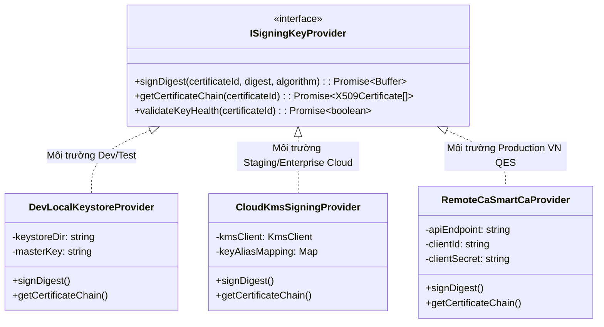
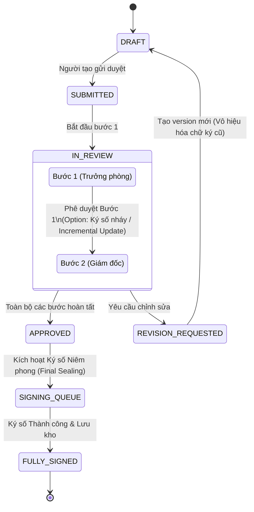
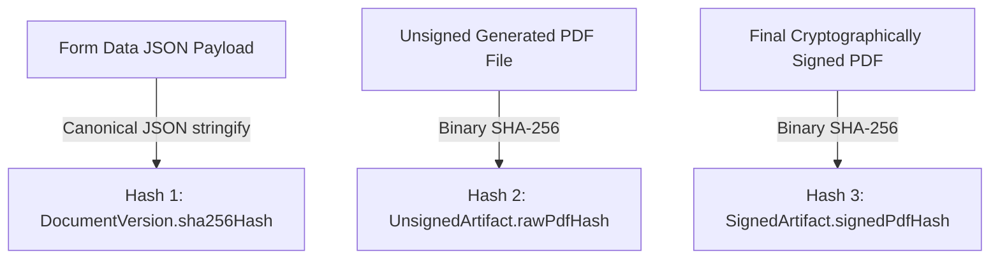
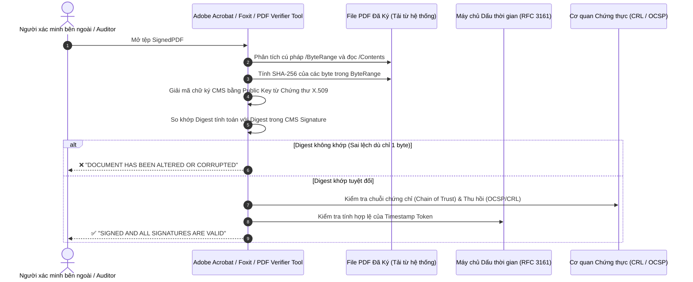
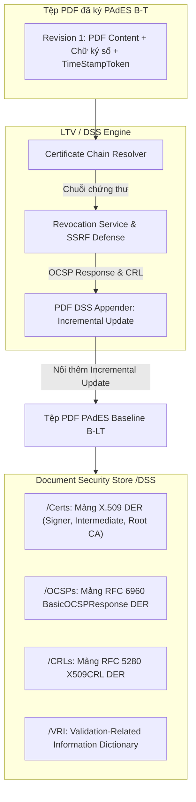

# KIẾN TRÚC KÝ SỐ MẬT MÃ PDF (CRYPTOGRAPHIC PDF DIGITAL SIGNING ARCHITECTURE)
*Dự án: Trình Ký Online Nội Bộ Doanh Nghiệp / Tập Đoàn (Monorepo)*  
*Giai đoạn: Phase 13.2.1 — Signing Provider, X.509 Certificate Registry & Secure Local Keystore*  
*Tác giả: Senior Cryptographic Engineer & Application Security Engineer*  
*Trạng thái: PHASE 13.2.1 HOÀN THÀNH — ĐÃ TRIỂN KHAI VÀ ĐẠT 100% KIỂM THỬ (Sẵn sàng cho Phase 13.2.2)*

---

## 1. TỔNG QUAN & BỐI CẢNH DỰ ÁN

Hệ thống Trình ký Online hiện là một monorepo pnpm bao gồm:
- `apps/web`: Next.js App Router (React, TailwindCSS/Vanilla CSS).
- `apps/api`: NestJS, Prisma ORM, PostgreSQL (chạy Docker/Cloud).
- `packages/shared`: Workflow FSM, Zod schema validation, Enums, Types.

Trải qua các giai đoạn từ Phase 1 đến Phase 12.1.1, hệ thống đã hoàn thiện:
1. Xác thực đa người dùng, RBAC 3 cấp (`SUPER_ADMIN`, `ADMIN`, `USER`), cô lập dữ liệu đa doanh nghiệp (Multi-tenant Organization Isolation).
2. Thiết kế và quản lý vòng đời biểu mẫu (Form Template & Version Snapshots).
3. Thiết kế và điều phối quy trình phê duyệt động (Workflow Template, Step Assignees, OCC, Deadlock prevention).
4. Phê duyệt nâng cao: Chuyển giao người duyệt (Reassignment), cảnh báo thời hạn (SLA Scheduler worker), thông báo tức thời (In-App Notifications), và Động cơ Ủy quyền có chính sách (Delegation Policy Engine với Temporal Directed Cycle Detection và Pessimistic Row Locking).

Tuy nhiên, **tính năng ký hiện tại của hệ thống hoàn toàn mới chỉ dừng lại ở tầng logic nghiệp vụ và hiển thị giao diện**. Mục tiêu của Phase 13 là thiết kế và xây dựng một hệ thống **Ký số Mật mã PDF (Cryptographic PDF Digital Signature)** có thể **xác minh độc lập (Independently Verifiable)** bởi các công cụ phần mềm quốc tế (Adobe Acrobat Reader, Foxit Reader, OpenSSL, pdf-lib) mà không phụ thuộc vào cơ sở dữ liệu nội bộ của ứng dụng.

---

## 2. BÁO CÁO HIỆN TRẠNG & KHOẢNG CÁCH SO VỚI KÝ SỐ MẬT MÃ THỰC TẾ

### 2.1. Kiểm tra mã nguồn hiện tại (As-Is Codebase Audit)

Qua rà soát trực tiếp schema Prisma (`apps/api/prisma/schema.prisma`), dịch vụ điều phối quy trình (`apps/api/src/modules/workflow/workflow-orchestrator.service.ts`), và các types chia sẻ (`packages/shared/src/types.ts`):

1. **Bảng `SignatureEvent`:**
   ```prisma
   model SignatureEvent {
     id                 String          @id @default(uuid())
     documentId         String
     documentVersionId  String
     stepId             String
     userId             String
     signatureImageUrl  String
     contentHash        String          // SHA-256 của formData
     ipAddress          String?
     userAgent          String?
     signedAt           DateTime        @default(now())
     isValid            Boolean         @default(true)
     invalidatedReason  String?
     invalidatedAt      DateTime?
   }
   ```
   - Trường `signatureImageUrl`: Lưu đường dẫn ảnh PNG/SVG chữ ký vẽ tay của người dùng (tạo từ canvas frontend).
   - Trường `contentHash`: Lưu mã băm SHA-256 được tính trên chuỗi JSON chuẩn hóa (`canonicalizeJson(formData)`) của phiên bản tài liệu.
   - **Khoảng cách**: Đây chỉ là bản ghi lịch sử kiểm toán (Audit Attribution Record) kết hợp ảnh chữ ký trực quan. Nó **hoàn toàn không phải là một chữ ký số mật mã** gắn vào tệp PDF.

2. **Bảng `DocumentVersion`:**
   - Các trường `renderedHtml` và `pdfUrl` hiện có trong schema nhưng **chưa từng được sinh ra hay lưu trữ**. Toàn bộ quy trình hiện tại chỉ xử lý dữ liệu form dưới dạng JSON object trong PostgreSQL.
   - Chưa hề tồn tại module sinh PDF (PDF Generation Engine) hay dịch vụ lưu trữ tệp (File/Object Storage Service).

3. **Thư viện phụ thuộc:**
   - Trong `apps/api/package.json` hoàn toàn chưa cài đặt bất kỳ thư viện xử lý PDF (như `pdf-lib`, `puppeteer`, `node-signpdf`) hay thư viện mật mã X.509/PKI (như `@peculiar/x509`, `node-forge`).

### 2.2. Phân định rõ 5 tầng khái niệm trong Ký duyệt (The 5 Tiers of Signatures)

Để tránh nhầm lẫn nghiêm trọng trong thiết kế và phát ngôn pháp lý, hệ thống xác lập rõ 5 khái niệm riêng biệt:

| Tầng | Khái niệm | Định nghĩa kỹ thuật | Vai trò trong hệ thống |
| :--- | :--- | :--- | :--- |
| **Tầng 1** | **Hành động nghiệp vụ (Business Approval Action)** | Bản ghi `StepDecisionHistory` ghi nhận User X bấm nút "Duyệt" tại thời điểm T với vai trò R. | Chuyển trạng thái máy FSM, kích hoạt bước kế tiếp. |
| **Tầng 2** | **Ảnh chữ ký (Visual Signature Representation)** | Tệp ảnh PNG/SVG/Font thể hiện nét vẽ chữ ký hoặc con dấu của người dùng. | Trình bày trực quan trên trang PDF phục vụ thị giác con người. Không có giá trị chứng minh tính toàn vẹn byte. |
| **Tầng 3** | **Chữ ký số mật mã (Cryptographic PDF Digital Signature)** | Khối dữ liệu nhị phân CMS/PKCS#7 detached signature được chèn vào từ điển `/Contents` của PDF, bao phủ bảng `/ByteRange`. | Chứng minh toán học: (1) Ai ký (qua khóa riêng), (2) Byte PDF không bị sửa đổi sau khi ký. |
| **Tầng 4** | **Chứng thư số X.509 (X.509 Public Key Certificate)** | Cấu trúc dữ liệu ASN.1 được ký bởi CA chứa khóa công khai của người ký, thông tin danh tính (Subject DN), thời hạn và mục đích sử dụng. | Định danh chủ thể sở hữu khóa riêng tương ứng với chữ ký số. |
| **Tầng 5** | **Dấu thời gian tin cậy (Trusted Timestamp - TSA)** | Token RFC 3161 do Timestamp Authority độc lập cấp, ký trên hash của chữ ký số tại thời điểm xác định. | Chứng minh chữ ký đã tồn tại trước một thời điểm, bảo vệ chữ ký ngay cả khi chứng thư X.509 hết hạn trong tương lai. |

> [!CRITICAL]
> **Tuyên bố Giới hạn Pháp lý:**  
> Hệ thống được thiết kế theo các tiêu chuẩn kỹ thuật quốc tế (PDF ISO 32000-1/2, ETSI PAdES). Tuy nhiên, để đạt giá trị pháp lý là **Chữ ký số công cộng** hoặc **Chữ ký số chuyên dùng bảo đảm an toàn** theo **Luật Giao dịch điện tử 2023** và **Nghị định 130/2018/NĐ-CP** của Việt Nam, khóa riêng và chứng thư số bắt buộc phải được cấp bởi một **Tổ chức cung cấp dịch vụ chứng thực chữ ký số công cộng (CA công cộng được Bộ Thông tin và Truyền thông cấp phép)** hoặc hệ thống CA chuyên dùng được công nhận. Các chứng thư tự ký (Self-signed) hoặc PKI nội bộ thử nghiệm trong môi trường Dev/Demo **chỉ có giá trị kỹ thuật thử nghiệm và bằng chứng nội bộ**, không tự động tương đương với chữ ký số theo quy định pháp luật.

---

## 3. THIẾT KẾ LUỒNG TẠO PDF (PDF GENERATION PIPELINE)

Để có thể ký số, trước hết phải có một tệp nhị phân PDF bất biến được sinh ra từ dữ liệu tài liệu.

```mermaid
flowchart TD
    A[Document Version Snapshot<br/>JSON formData + Template HTML] --> B[HTML Normalization & Sanitization]
    B --> C[Visual Signature Placement & Visual Stamp Rendering]
    C --> D[Headless PDF Engine<br/>Chromium / PDFKit]
    D --> E[Canonical PDF Byte Generation]
    E --> F[Compute SHA-256 Hash of Unsigned PDF]
    F --> G[Store Unsigned PDF Artifact<br/>artifacts/unsigned/{docId}_v{ver}.pdf]
    G --> H[Ready for Cryptographic Signing]
```

### 3.1. Tính bất biến của phiên bản nguồn
- Tài liệu chỉ được tạo PDF từ **phiên bản bất biến (Immutable Snapshot)**. Khi tài liệu ở trạng thái `IN_REVIEW` hoặc sau khi đạt `APPROVED`, dữ liệu `formData` đã được khóa cố định.
- Mã băm `sha256Hash` của `DocumentVersion` (JSON canonical) là căn cứ đối chiếu tính toàn vẹn nghiệp vụ.

### 3.2. Động cơ kết xuất PDF (Rendering Engine Options)
Đánh giá 2 phương án cho Backend NestJS:
1. **Phương án A: Headless Chromium (Puppeteer / Playwright):**
   - *Ưu điểm*: Hỗ trợ 100% CSS hiện đại, Flexbox, Grid, font tiếng Việt chuẩn UTF-8, bố cục văn bản hành chính bảng biểu phức tạp giống hệt màn hình giao diện.
   - *Nhược điểm*: Chi phí tài nguyên (RAM, CPU), thời gian khởi động cold-start khoảng 500ms - 1s.
2. **Phương án B: Native PDF Generator (`pdf-lib` / `pdfkit`):**
   - *Ưu điểm*: Cực nhẹ, tốc độ cao (vài chục ms), tốn rất ít RAM.
   - *Nhược điểm*: Phải tự vẽ layout, tọa độ x/y, xử lý font chữ tiếng Việt (cần nhúng TTF/OTF) rất phức tạp với các biểu mẫu động nhiều trang.

**Quyết định kiến trúc:**
- Sử dụng kiến trúc kết hợp:
  - **Tạo bản mẫu văn bản gốc**: Dùng Headless Engine (hoặc template HTML-to-PDF có kiểm soát) sinh ra PDF gốc chuẩn khổ giấy A4, nhúng sẵn font chuẩn Unicode (Inter/Roboto).
  - **Gắn trang chữ ký và xử lý nhị phân**: Dùng `pdf-lib` để thao tác chèn placeholder chữ ký số, điều chỉnh metadata PDF và chuẩn bị cho ByteRange.

---

## 4. THIẾT KẾ BỘ MÁY KÝ SỐ PDF (PDF CRYPTOGRAPHIC SIGNING ENGINE)

Chữ ký số trên PDF phải tuân thủ chuẩn **ISO 32000-1 (PDF 1.7) / ISO 32000-2 (PDF 2.0)** và tiêu chuẩn chữ ký số châu Âu **ETSI EN 319 142 (PAdES)**.

```mermaid
flowchart LR
    subgraph PDF File Structure
        A[Header: %PDF-1.7]
        B[Body Objects: Text, Fonts, Pages]
        C[Signature Dictionary: /ByteRange [0, o1, o2, len2]]
        D[Placeholder: /Contents <0000...0000>]
        E[Trailer & Cross Reference Table]
    end
    
    subgraph Signing Process
        F[Read Bytes 0..o1 and o2..EOF]
        G[Compute SHA-256 Digest of ByteRanges]
        H[Send Digest to Key Provider]
        I[Sign Digest with Private Key RSA/ECDSA]
        J[Build CMS/PKCS#7 Structure + X.509 Chain]
        K[Inject DER Hex into /Contents]
    end

    A -.-> F
    B -.-> F
    E -.-> F
    F --> G --> H --> I --> J --> K
    K -.-> D
```

### 4.1. Cơ chế PDF ByteRange và Placeholder

Một tệp PDF không thể tự băm toàn bộ chính nó rồi lưu mã băm vào trong chính nó (gây ra nghịch lý đệ quy). Chuẩn PDF giải quyết bài toán này bằng cơ chế `/ByteRange`:
1. Trong file PDF, tạo một Signature Dictionary kiểu `/Sig` với khóa con `/Filter /Adobe.PPKLite` và `/SubFilter /adbe.pkcs7.detached` hoặc `/ETSI.CAdES.detached` (PAdES).
2. Tạo một khoảng trống dữ liệu hex rỗng trong trường `/Contents <00000000...00000000>` với độ dài cố định dự phòng (thường là 8192 hoặc 16384 bytes để chứa đủ chữ ký CMS kèm chuỗi chứng thư số và timestamp).
3. Trường `/ByteRange [offset1, length1, offset2, length2]` chỉ rõ:
   - Đoạn 1: Từ byte `0` đến ngay trước dấu `<` của `/Contents`.
   - Đoạn 2: Từ ngay sau dấu `>` của `/Contents` đến hết byte cuối cùng của tệp PDF (`EOF`).
4. Toàn bộ các byte nằm trong 2 khoảng này được băm bằng thuật toán SHA-256.
5. Chữ ký số CMS/PKCS#7 (đã mã hóa hash bằng khóa riêng) được chuyển thành chuỗi Hexadecimal và ghi đè chính xác vào vùng trống `/Contents` mà không làm dịch chuyển bất kỳ offset byte nào của tệp PDF.

### 4.2. Bảo toàn chữ ký trước bằng Incremental Updates (PAdES Multi-Signer)

Trong quy trình trình ký doanh nghiệp, một tài liệu thường có nhiều cấp duyệt tuần tự (ví dụ: Nhân viên lập $\rightarrow$ Trưởng phòng ký nháy $\rightarrow$ Giám đốc ký duyệt chính thức).

> [!IMPORTANT]
> **Quy tắc Bất di bất dịch của PDF Signing:**  
> Nếu người thứ 2 mở file PDF đã ký của người thứ 1, sửa trực tiếp vào nội dung cũ hoặc lưu đè (full rewrite), bảng offset của ByteRange của người thứ 1 sẽ bị sai lệch, dẫn tới Adobe Acrobat Reader báo lỗi đỏ: **"Document has been altered or corrupted since it was signed"**.

Để bảo toàn các chữ ký trước:
1. Hệ thống **BẮT BUỘC** áp dụng chuẩn **Incremental Update (Cập nhật gia tăng)** theo ISO 32000.
2. File PDF gốc và các chữ ký trước được giữ nguyên 100% đến byte cuối cùng (`EOF` trước).
3. Chữ ký mới được thêm vào bằng cách:
   - Nối tiếp (append) một phần thân mới chứa đối tượng chữ ký mới.
   - Nối tiếp một bảng tham chiếu chéo (XRef Table hoặc XRef Stream) mới chỉ chứa các đối tượng vừa bổ sung.
   - Nối tiếp một trailer mới có trường `/Prev` trỏ về offset của bảng XRef trước đó.
4. Khi mở file, trình xem PDF kiểm tra:
   - Chữ ký 1 bao phủ từ byte 0 đến EOF_1 (Toàn vẹn hoàn hảo cho phiên bản 1).
   - Chữ ký 2 bao phủ từ byte 0 đến EOF_2 thông qua Incremental Update hợp lệ được cho phép (Thêm form field chữ ký mới mà không sửa nội dung trang đã duyệt).
   - Cả 2 chữ ký đều hiển thị màu xanh: **"All signatures are valid"**.

### 4.3. Các cấp độ tuân thủ PAdES (PAdES Profiles)

Hệ thống định hướng triển khai các cấp độ PAdES theo lộ trình:
- **PAdES B-B (Baseline Basic):** Ký CMS PKCS#7 detached signature, nhúng chứng thư số người ký, thuật toán SHA-256. (Mục tiêu Phase 13.2).
- **PAdES B-T (Baseline with Timestamp):** Bổ sung Token RFC 3161 từ máy chủ cấp dấu thời gian (TSA) vào chữ ký để bảo đảm thời điểm ký không thể bị giả mạo bởi đồng hồ cục bộ server. (Mục tiêu Phase 13.3).
- **PAdES B-LT / B-LTA (Long Term Validation):** Nhúng toàn bộ bằng chứng xác thực (DSS - Document Security Store gồm CRL, OCSP responses) và Document Timestamp để tệp PDF có thể kiểm tra tính hợp lệ sau 10 - 20 năm ngay cả khi CA gốc đã ngừng hoạt động. (Định hướng tương lai).

---

## 5. KIẾN TRÚC QUẢN LÝ KHÓA RIÊNG & CHỨNG THƯ SỐ (KEY & CERTIFICATE MANAGEMENT)

Khóa riêng (Private Key) là tài sản tối mật. Việc lộ khóa riêng đồng nghĩa với việc kẻ tấn công có thể giả mạo danh tính của tổ chức hoặc cá nhân trên mọi văn bản pháp lý.



### 5.1. So sánh các mô hình lưu trữ và quản lý khóa

| Tiêu chí | Phương án 1: Dev Encrypted Keystore (PKCS#12) | Phương án 2: Cloud KMS / HSM (AWS KMS / Azure Key Vault) | Phương án 3: Remote CA / SmartCA (VNPT, Viettel, FPT) |
| :--- | :--- | :--- | :--- |
| **Môi trường phù hợp** | Local Development, CI/CD Automated Test, Demo nội bộ. | Doanh nghiệp triển khai trên Private Cloud / AWS / Azure. | Production tại Việt Nam cần giá trị pháp lý theo Luật GDĐT 2023. |
| **Bảo vệ khóa riêng** | Khóa mã hóa lưu trên disk/secret store, giải mã trong RAM bằng biến môi trường. | Khóa nằm trong phần cứng FIPS 140-2 Level 3 HSM, không bao giờ xuất (export) ra ngoài. | Khóa nằm tại máy chủ bảo mật của nhà cấp chứng thư số công cộng (CA). |
| **Quyền sở hữu khóa** | Nhóm phát triển tạo chứng thư tự ký (Self-signed) hoặc Root CA nội bộ. | Tổ chức sở hữu tài khoản Cloud KMS, kiểm soát IAM Policy. | Người dùng cá nhân/doanh nghiệp đăng ký chính danh với CA. |
| **Xác thực người ký** | Khóa dùng chung cho tenant hoặc sinh tự động cho user test. | IAM Role của Backend kết hợp kiểm tra quyền trong DB. | Người dùng xác thực 2 lớp qua OTP/App SmartCA trước mỗi lượt ký. |
| **Rủi ro rò rỉ** | Nếu server bị chiếm quyền root hoặc lộ biến môi trường, khóa có thể bị trích xuất. | Khóa không thể bị đọc trực tiếp; chỉ có rủi ro bị lạm dụng quyền gọi API KMS. | Khóa được bảo vệ theo chuẩn an toàn của CA quốc gia. |
| **Chi phí & Độ trễ** | Miễn phí, độ trễ ký < 10ms. | Chi phí theo số lượt request KMS (rất rẻ), độ trễ 50-150ms. | Phí bản quyền theo chứng thư/năm hoặc lượt ký, độ trễ 1-3s (phụ thuộc network CA & OTP). |

### 5.2. Nguyên tắc An toàn Tuyệt đối về Khóa Riêng (Non-Negotiable Key Rules)
1. **Không rò rỉ Frontend**: Khóa riêng **TUYỆT ĐỐI KHÔNG BAO GIỜ** được gửi về trình duyệt người dùng qua bất kỳ API nào.
2. **Không ghi Log**: Bộ lọc log (Pino/NestJS logger) phải cấu hình chặn bắt các trường `privateKey`, `passphrase`, `secretKey`, `pkcs12`.
3. **Không lưu Plaintext trong DB**: Database PostgreSQL chỉ lưu trữ thông tin công khai: `certificateId`, `subjectDn`, `issuerDn`, `validFrom`, `validTo`, `serialNumber`, `publicKeyPem`, `fingerprintSha256`. Nếu có lưu tệp PKCS#12 cho môi trường Dev, toàn bộ file phải được mã hóa bằng AES-256-GCM với Key Encryption Key (KEK) lấy từ biến môi trường máy chủ bảo mật.
4. **Cô lập Đa Doanh nghiệp (Tenant Isolation)**:
   - Mỗi chứng thư và khóa đều có trường `organizationId`.
   - Một yêu cầu ký thuộc `organizationId = A` **KHÔNG BAO GIỜ** được phép kích hoạt khóa thuộc `organizationId = B`. Logic phân quyền phải kiểm tra nghiêm ngặt `certificate.organizationId === document.organizationId`.

### 5.3. Vòng đời Chứng thư số (Certificate Lifecycle)
- **Cấp phát (Issuance)**: Gắn chứng thư với định danh người dùng (`userId`) hoặc con dấu tổ chức (`organizationId`).
- **Kích hoạt (Activation)**: Trạng thái `ACTIVE` khi đã vượt qua bước xác thực danh tính.
- **Luân chuyển (Rotation)**: Hỗ trợ nạp chứng thư mới trước khi chứng thư cũ hết hạn 30 ngày. Các tài liệu đã ký bằng chứng thư cũ vẫn giữ nguyên giá trị toàn vẹn.
- **Hết hạn (Expiration)**: Hệ thống định kỳ cảnh báo chứng thư sắp hết hạn qua thông báo quản trị viên. Chặn mọi yêu cầu ký mới nếu `validTo < now()`.
- **Thu hồi (Revocation)**: Trạng thái `REVOKED`. Ghi nhận thời điểm thu hồi, lý do thu hồi (lộ khóa, nhân sự nghỉ việc). Các chữ ký thực hiện **sau** thời điểm thu hồi sẽ bị coi là không hợp lệ.

---

## 6. QUY TRÌNH WORKFLOW, ĐIỀU KIỆN KÝ & LIÊN KẾT ỦY QUYỀN

### 6.1. Thời điểm ký số và Điều kiện được ký
Hệ thống hỗ trợ 2 mô hình ký số trong vòng đời tài liệu:



1. **Ký số Niêm phong Hoàn tất (Final Archival Seal - Default):**
   - Tài liệu chỉ thực hiện ký số mật mã khi trạng thái workflow đạt `APPROVED` (toàn bộ các bước duyệt đã thông qua).
   - Con dấu số của tổ chức (Organization Digital Seal) hoặc Chữ ký số của người đại diện có thẩm quyền cao nhất được gắn vào tài liệu để đóng băng pháp lý vĩnh viễn văn bản.
2. **Ký số Từng bước (Per-Step Incremental Signing):**
   - Cấu hình tại từng bước của `WorkflowTemplate`: Cho phép người duyệt ở mỗi bước khi bấm "APPROVED" sẽ thực hiện ký số mật mã lên tệp PDF.
   - Mỗi bước ký bổ sung một Incremental Update vào PDF theo thứ tự thời gian.

### 6.2. Liên kết Ký số với Ủy quyền (Delegation Attribution)
Kế thừa thành quả của Phase 12.1 và Phase 12.1.1:
- Nếu Phó giám đốc B ký duyệt thay cho Giám đốc A theo chính sách ủy quyền `delegationPolicyId`:
  - Người ký thực tế (Actual Signer): `Deputy B` (`userId = B`).
  - Người ủy quyền (Delegator): `Director A` (`delegatedFromUserId = A`).
  - Chứng thư số được sử dụng để ký:
    - Nếu ký bằng chứng thư cá nhân: Bắt buộc dùng chứng thư của `Deputy B`.
    - Nếu ký bằng chứng thư con dấu công ty: Gắn thông tin metadata chữ ký: *"Ký thay mặt Giám đốc A theo Giấy ủy quyền số X"*.
  - Audit Trail ghi nhận liên kết 4 thành phần: `Actual Actor` + `Delegator` + `DelegationPolicy` + `Certificate Serial & Subject DN`.
- **Tuyệt đối không có chuyện Delegation tự động sinh chữ ký số**: Việc ủy quyền chỉ cấp quyền thực hiện hành động duyệt; người nhận ủy quyền phải chủ động thực hiện ký và xác thực danh tính tại thời điểm ký.

### 6.3. Xử lý Chỉnh sửa & Vô hiệu hóa (Revision Handling)
- Khi một cấp duyệt yêu cầu chỉnh sửa (`REVISION_REQUESTED`):
  - Toàn bộ bản ghi `SignatureEvent` của phiên bản hiện tại chuyển `isValid = false`.
  - Phiên bản PDF đã ký trước đó vẫn được lưu trữ nguyên vẹn trong kho lưu trữ phiên bản lịch sử để phục vụ thanh tra/kiểm toán (Audit Archive), nhưng **không được coi là phiên bản hiệu lực cuối cùng**.
  - Khi tác giả gửi lại (`RESUBMIT`), một `DocumentVersion` mới với mã băm mới được tạo ra. Toàn bộ quy trình ký duyệt bắt đầu lại từ đầu trên tệp PDF mới.

### 6.4. Chống ký trùng lặp & Xử lý Tương tranh (Concurrency & Idempotency)
- Sử dụng **Idempotency Key**: Mỗi request ký mang theo một `signingRequestId` độc nhất.
- Sử dụng **PostgreSQL Transaction Advisory Lock**:
  - `SELECT pg_advisory_xact_lock(hashtext('doc_signing_' || documentId)::bigint);`
  - Đảm bảo nếu 2 request ký đồng thời gửi tới server (do mạng chập chờn hoặc người dùng click đúp), request thứ hai sẽ phải đợi request thứ nhất hoàn tất và nhận ngay kết quả đã ký thành công mà không ký lần hai.

---

## 7. THIẾT KẾ LƯU TRỮ VÀ BẢO ĐẢM TOÀN VẸN (STORAGE & INTEGRITY)

### 7.1. Mô hình Ba Tầng Mã Băm (The 3-Tier Hash Model)

Để đảm bảo tính toàn vẹn và dễ dàng định vị lỗi nếu có sai lệch dữ liệu, hệ thống lưu trữ 3 mã băm SHA-256 độc lập:



1. **Hash 1 - Form Data Hash (`DocumentVersion.sha256Hash`):** Băm trên chuỗi JSON canonical của các trường form dữ liệu. Bảo đảm dữ liệu người dùng nhập không bị can thiệp ở tầng database.
2. **Hash 2 - Unsigned PDF Hash (`rawPdfHash`):** Băm trên toàn bộ nhị phân của tệp PDF được render trước khi ký.
3. **Hash 3 - Signed PDF Hash (`signedPdfHash`):** Băm trên toàn bộ nhị phân của tệp PDF sau khi đã chèn chữ ký số CMS vào trường `/Contents`. Đây là mã băm định danh tài sản số cuối cùng được lưu trữ trên storage.

### 7.2. Trừu tượng hóa Kho Lưu trữ (Storage Abstraction)
Hệ thống sử dụng interface `IStorageProvider`:
```typescript
export interface IStorageProvider {
  uploadArtifact(tenantId: string, path: string, content: Buffer, mimeType: string): Promise<StorageResult>;
  downloadArtifact(tenantId: string, path: string): Promise<Buffer>;
  artifactExists(tenantId: string, path: string): Promise<boolean>;
  deleteArtifact(tenantId: string, path: string): Promise<void>;
}
```
- **Local Disk Storage Provider**: Sử dụng thư mục có kiểm soát phân quyền hệ điều hành (dành cho Dev/Test): `storage/tenants/{tenantId}/documents/{docId}/...`
- **S3-Compatible Object Storage Provider**: Sử dụng AWS S3, MinIO, hoặc Cloudflare R2 (dành cho Production) với cấu hình Bucket Policy và SSE-S3 (Server-Side Encryption).

### 7.3. Xử lý Bất đồng bộ File/Database (Two-Phase Persistence Recovery)
Khi ký số:
1. Sinh file PDF ký số trong RAM/Buffer.
2. Tính `signedPdfHash`.
3. Tải file lên storage với đường dẫn định danh bất biến (Immutable URI).
4. Mở PostgreSQL transaction để lưu thông tin chữ ký, cập nhật trạng thái document và ghi audit log.
5. Nếu bước 4 thất bại (DB crash, rollback):
   - Kích hoạt cơ chế dọn dẹp (compensating transaction) xóa tệp rác trên storage hoặc đánh dấu file mồ côi (orphan file).
   - Trả về mã lỗi 500 kèm mã trace để retry an toàn.
   - Không bao giờ có tình trạng: DB báo ký thành công nhưng storage không có file, hoặc storage có file nhưng DB không ghi nhận.

---

## 8. THIẾT KẾ XÁC MINH ĐỘC LẬP (INDEPENDENT VERIFICATION PIPELINE)

Hệ thống được thiết kế để bất kỳ bên thứ ba nào cũng có thể kiểm tra tính hợp lệ của tệp PDF mà **hoàn toàn không cần truy cập vào API hay database của ứng dụng Trình ký Online**.



### 8.1. Các tầng kiểm tra xác minh độc lập
1. **Kiểm tra Toàn vẹn Nhị phân (Integrity Check):**
   - Đọc các khoảng byte chỉ định trong mảng `/ByteRange`.
   - Tính mã băm SHA-256 trên các byte đó.
   - Giải mã giá trị băm từ chữ ký CMS bằng khóa công khai trích xuất từ chứng thư số nhúng trong PDF.
   - So khớp: Nếu lệch 1 bit duy nhất, kết luận: Tài liệu đã bị can thiệp trái phép sau khi ký.
2. **Kiểm tra Tính Đích thực của Chứng thư (Authenticity & Chain Validation):**
   - Trích xuất chuỗi chứng thư từ CMS payload (Leaf $\rightarrow$ Intermediate CA $\rightarrow$ Root CA).
   - Kiểm tra xem Root CA có nằm trong danh sách tin cậy (AATL - Adobe Approved Trust List hoặc Trust Store của hệ điều hành/trình xác minh) hay không.
3. **Kiểm tra Thời hạn & Trạng thái Thu hồi (Revocation Status):**
   - Kiểm tra ngày ký so với thời gian hiệu lực `notBefore` và `notAfter` của chứng thư.
   - Truy vấn giao thức kiểm tra trạng thái chứng thư trực tuyến (OCSP) hoặc danh sách chứng chỉ bị thu hồi (CRL) để đảm bảo chứng thư không bị thu hồi tại thời điểm ký.
4. **Kiểm tra Dấu thời gian Tin cậy (Timestamp Verification):**
   - Giải mã RFC 3161 Timestamp Token nhúng trong thuộc tính `unauthenticatedAttributes` của CMS.
   - Xác minh chữ ký của TSA trên messageDigest của chữ ký số PDF.

---

## 9. ĐỀ XUẤT CÁC MODULE NESTJS DÀNH CHO PHASE 13

## 9. CÁC MODULE ĐÃ TRIỂN KHAI CHO GIAI ĐOẠN 13.2.1

Trong Phase 13.2.1, hệ thống đã hoàn thiện module quản lý khóa và danh mục chứng thư số (`SigningModule`):

```
apps/api/src/modules/signing/
├── signing.module.ts                         # Đăng ký providers và controllers vào AppModule
├── certificate.controller.ts                 # REST API quản lý chứng thư và kiểm thử ký
├── certificate-registry.service.ts           # Nghiệp vụ quản lý vòng đời chứng thư X.509
├── dev-keystore-generator.ts                 # Tiện ích tạo PKCS#12 tự ký cho môi trường DEV
└── providers/
    ├── signing-key-provider.interface.ts     # Hợp đồng trừu tượng ISigningKeyProvider
    ├── remote-signing.interface.ts           # Hợp đồng mở rộng cho Remote KMS/HSM/SmartCA
    ├── dev-local-keystore.provider.ts        # Provider phát triển với local PKCS#12 (.p12)
    └── cloud-kms-signing.provider.ts         # Adapter stub cho Cloud KMS / VNPT SmartCA
```

### 9.1. Hợp đồng `ISigningKeyProvider`
- **Không bao giờ trả Private Key ra ngoài**: Mọi thao tác ký được đóng gói trong provider.
- **Rõ ràng ngữ nghĩa đầu vào (Input Semantics)**:
  - `signData(keyAlias, rawData)`: Nhận buffer dữ liệu thô, provider tự băm SHA-256 và ký RSASSA-PKCS1-v1_5.
  - `signDigest(keyAlias, digest32Bytes)`: Nhận chính xác 32-byte SHA-256 digest, provider bọc ASN.1 `DigestInfo` (`3031300d060960864801650304020105000420`) và mã hóa RSA private key padding `RSA_PKCS1_PADDING`.
  - Hai phương thức trên cho ra kết quả tương thích 100% với nhau và đối soát khớp hoàn hảo với `crypto.verify('sha256', rawData, publicKeyPem, sig)`.

### 9.2. Bảo mật Local Keystore (`DevLocalKeystoreProvider`)
- Tệp keystore được lưu tại `apps/api/storage/keystores/dev/{keyAlias}.p12`, nằm ngoài web root.
- Chặn đứng tấn công duyệt thư mục (Path Traversal) bằng regex `^[a-zA-Z0-9_-]+$`.
- Mật khẩu giải mã lấy qua biến môi trường `DEV_SIGNING_PASSPHRASE`. Tuyệt đối không hardcode trong mã nguồn, không ghi log mật khẩu hoặc buffer nhị phân.
- Tự động kiểm tra tính tương khớp giữa cặp khóa RSA và chứng thư số X.509 tại thời điểm import.

### 9.3. Danh mục Chứng thư X.509 (`DigitalCertificate`)
- Lưu trữ trong cơ sở dữ liệu PostgreSQL với các trường: `fingerprintSha256` (Unique), `serialNumber`, `subjectDn`, `issuerDn`, `validFrom`, `validTo`, `status` (`ACTIVE`, `REVOKED`, `EXPIRED`), `keyStorageType`, `keyAlias`.
- Chỉ lưu `certificatePem` (Khóa công khai). **Tuyệt đối không lưu khóa riêng** trong CSDL.
- **Phân quyền và Cô lập Đa tổ chức (Tenant Isolation)**:
  - Chỉ `ADMIN` và `SUPER_ADMIN` mới được phép đăng ký hoặc thu hồi (`REVOKED`) chứng thư.
  - `USER` chỉ được xem chứng thư cá nhân của chính mình.
  - Chặn triệt để hành vi ký mạo danh hoặc ký bằng chứng thư của tổ chức khác (HTTP 403 Forbidden).
  - Không cho phép cập nhật thay đổi `organizationId` hoặc `userId` trên chứng thư đã tạo.

### 9.4. Cơ chế chuyển đổi sang Remote Provider (KMS / HSM)
- Khi triển khai môi trường Production, `ISigningKeyProvider` sẽ được inject bằng `CloudKmsSigningProvider` hoặc `SmartCaSigningProvider`.
- Ứng dụng chỉ cần thay đổi cấu hình `keyStorageType` trong bảng `DigitalCertificate`, toàn bộ logic ký CMS và xác minh giữ nguyên không thay đổi.

### 9.5. Kiến trúc CMS/PDF Signing Engine (Hoàn thành trong Phase 13.2.2)

Hệ thống đã triển khai đầy đủ các module chuyên trách trong `apps/api/src/modules/signing/engine/`:

```
apps/api/src/modules/signing/
├── document-signing.controller.ts            # REST API ký số, xác minh và tải PDF đã ký
├── engine/
│   ├── cms-signature.builder.ts              # Xây dựng chữ ký CMS Detached (RFC 5652)
│   ├── pdf-signature.adapter.ts              # Chèn Signature Dictionary, ByteRange và nhúng CMS
│   ├── pdf-signature.verifier.ts             # Phân tích ByteRange, so khớp digest và verify RSA
│   └── pdf-signing.service.ts                # Điều phối quy trình ký an toàn fail-closed
```

1. **`CmsSignatureBuilder` (RFC 5652 CMS Detached Signature Builder)**:
   - Dựng cấu trúc ASN.1 DER CMS `ContentInfo` $\rightarrow$ `signedData`.
   - `encapContentInfo`: Object Identifier `id-data` (`1.2.840.113549.1.7.1`), `eContent` để trống (detached mode chuẩn ISO 32000-1).
   - Nhúng chuỗi chứng thư số X.509 (`certificates [0] IMPLICIT`).
   - Sắp xếp từ điển (Lexicographical DER sorting) các thuộc tính ký (`SignedAttributes`): `contentType`, `signingTime`, `messageDigest` (= SHA-256 của byte PDF theo `/ByteRange`).
   - Gọi `ISigningKeyProvider.signDigest` với 32-byte hash của SignedAttributes DER. Không bao giờ xuất khóa riêng.

2. **`PdfSignatureAdapter` (PDF Structure & ByteRange Allocation)**:
   - Sử dụng `pdf-lib` để cấp phát Signature Dictionary: `/Type /Sig`, `/Filter /Adobe.PPKLite`, `/SubFilter /adbe.pkcs7.detached`, `/ByteRange`, `/Contents <0000...0000>`.
   - Tính toán chính xác vị trí offset byte của `/Contents` và `/ByteRange` nhị phân.
   - Chia tệp thành 2 đoạn: `[0, offset1]` và `[offset2, length2]`, loại trừ chính xác khoảng hex placeholder.
   - Kiểm tra chống tràn kích thước placeholder (Placeholder Overflow Protection).
   - Nhúng chuỗi DER hex của CMS vào vùng placeholder mà không làm dịch chuyển cấu trúc byte.

3. **`PdfSignatureVerifier` (Independent Self-Contained Verifier)**:
   - Phân tích cấu trúc `/ByteRange` từ PDF nhị phân, kiểm tra tính bao phủ (toàn bộ tệp PDF trừ vùng `/Contents`).
   - Tính toán độc lập `computedDigest` trên đúng 2 đoạn byte trong `/ByteRange`.
   - Trích xuất cấu trúc CMS từ hex `/Contents`, đọc `messageDigest` từ SignedAttributes và so sánh với `computedDigest`.
   - Tái tạo chuỗi byte của SignedAttributes (chuyển tag `[0]` thành `SET` 0x31) và dùng khóa công khai X.509 trích xuất từ chữ ký để xác minh chữ ký RSA (`RSASSA-PKCS1-v1_5` với SHA-256).
   - Phát hiện can thiệp nhị phân cấp byte (Tamper Detection): Chỉ cần sửa 1 bit trong nội dung được ký, `isDigestValid` và `isValid` lập tức trả về `false`.

4. **`PdfSigningService` (Orchestration & Data Flow)**:
   - Áp dụng PostgreSQL Advisory Locking (`pg_try_advisory_xact_lock`) theo `documentId` để ngăn xung đột tương tranh khi ký đồng thời.
   - Xác minh tệp đầu vào `OFFICIAL_UNSIGNED` khớp 100% với `rawPdfHash` lưu trong CSDL.
   - Thẩm định trạng thái chứng thư (`ACTIVE`, còn hạn, thuộc đúng tổ chức và người ký).
   - Ký số qua Adapter và Verifier; bắt buộc quy trình **Fail-closed**: chỉ khi self-verification đạt 100% mới ghi file vật lý vào Storage và cập nhật bản ghi `DocumentArtifact` kiểu `SIGNED_PDF`.
   - Ghi nhật ký kiểm toán `DOCUMENT_SIGN_PDF` kèm `signedPdfHash`, `certificateId`, `userId`, `organizationId`.

### 9.6. Kiến trúc RFC 3161 Trusted Timestamping & PAdES B-T Readiness (Hoàn thành trong Phase 13.3.1)

Trong Phase 13.3.1, hệ thống đã triển khai đầy đủ kiến trúc Trusted Timestamp Authority (TSA) theo RFC 3161, nhúng dấu thời gian tin cậy vào chữ ký số PDF hướng đến PAdES Baseline B-T:

```
apps/api/src/modules/signing/timestamp/
├── timestamp.interface.ts                    # Hợp đồng trừu tượng ITimestampAuthorityProvider
├── timestamp-token.verifier.ts               # Thẩm định độc lập RFC 3161 TimeStampToken & EKU
├── rfc3161-timestamp.client.ts               # Client RFC 3161: TimeStampReq / TimeStampResp ASN.1 DER
├── dev-test-tsa.provider.ts                  # Provider TSA nội bộ độc lập không phụ thuộc Internet
├── http-tsa.provider.ts                      # Provider kết nối TSA vendor thực tế qua HTTP/HTTPS có retry
└── timestamp.service.ts                      # NestJS Injectable service điều phối TSA và fail-closed policy
```

1. **Chuẩn hóa dữ liệu đầu vào theo RFC 3161 & PAdES B-T**:
   - Dữ liệu cần đóng dấu thời gian **bắt buộc là `signatureValue` octets** của người ký (chữ ký RSA 256 bytes từ `keyProvider.signDigest`), **tuyệt đối không nhầm lẫn** với PDF ByteRange digest.
   - `messageImprint`: SHA-256 của `signatureValue`.
   - Sinh `nonce` ngẫu nhiên 64-bit để chống tấn công phát lại (Replay Attacks).
   - Yêu cầu chứng thư TSA (`certReq: true`).

2. **Cấu trúc nhúng TimeStampToken vào CMS (ETSI EN 319 142-1 / PAdES B-T)**:
   - `TimeStampToken` (ContentInfo ASN.1 DER) được nhúng làm một `Attribute` không ký trong `SignerInfo.unsignedAttrs` (tag `[1] IMPLICIT`).
   - OID quy chuẩn: `1.2.840.113549.1.9.16.2.14` (`id-aa-signatureTimeStampToken`).
   - Vì nằm trong `unsignedAttrs`, việc nhúng timestamp token không làm thay đổi `signedAttrs` và **bảo toàn 100% chữ ký RSA ban đầu của người ký**.

3. **Thẩm định mật mã độc lập (`TimestampTokenVerifier`)**:
   - Phân tích cú pháp ASN.1 DER của `TimeStampToken` $\rightarrow$ `SignedData` $\rightarrow$ `TSTInfo`.
   - Đối soát `messageImprint.hashedMessage` khớp chính xác với `SHA-256(SignerInfo.signatureValue)`.
   - Đối soát `nonce` nếu request có gửi nonce.
   - Kiểm tra chứng thư TSA nhúng: Bắt buộc có Extended Key Usage `id-kp-timeStamping` (`1.3.6.1.5.5.7.3.8`).
   - Kiểm tra thời hạn hiệu lực: `notBefore <= genTime <= notAfter`.
   - Xác minh chữ ký số RSA của TSA trên `TSTInfo` và SignedAttributes chứa ESS `signingCertificateV2` (RFC 5035).

4. **Chính sách Vận hành Fail-Closed**:
   - Nếu `requireTimestamp: true`, hệ thống yêu cầu bắt buộc phải lấy và xác minh thành công TimeStampToken. Nếu TSA timeout, DNS lỗi, hoặc token không hợp lệ, giao dịch ký lập tức thất bại (fail-closed), **không bao giờ fallback sang đồng hồ hệ thống nội bộ**.
   - Bất kỳ can thiệp nhị phân nào vào tệp PDF hoặc timestamp token đều khiến `PdfSignatureVerifier.verify` đánh dấu `isTampered: true, isValid: false`.

---

---

## 10. KIẾN TRÚC PAdES BASELINE B-LT & DOCUMENT SECURITY STORE (DSS) (PHASE 13.3.2)



### 10.1. Nguyên lý PDF Incremental Update cho DSS (ISO 32000-1 clause 12.8.4 & ETSI EN 319 142-1 clause 5.4)
1. **Bảo toàn 100% ByteRange của Revision 1**:
   - Chữ ký số điện tử ban đầu bao phủ toàn bộ nội dung tài liệu trước đó qua cấu trúc ByteRange `[0, offset1, offset2, len2]`.
   - Bổ sung DSS được thực hiện thông qua **Incremental Update** chuẩn ISO 32000-1: các đối tượng indirect stream (`/Type /X509`, `/Type /OCSP`, `/Type /CRL`), từ điển `/DSS`, `/VRI` và bảng tham chiếu chéo `xref` mới được **ghi nối tiếp vào cuối tệp**.
   - ByteRange ban đầu và mã băm SHA-256 của Revision 1 **tuyệt đối không bị thay đổi hoặc vô hiệu hóa**.

2. **Cấu trúc Từ điển Document Security Store (`/DSS`)**:
   - `/Certs`: Danh sách tham chiếu indirect object chứa luồng byte nhị phân của tất cả chứng thư số trong đường dẫn xác thực (Signer, Intermediate CA, Root CA, TSA).
   - `/OCSPs`: Danh sách phản hồi OCSP (RFC 6960) nhị phân ASN.1 DER đã được ký số hợp lệ bởi CA.
   - `/CRLs`: Danh sách thu hồi chứng thư số CRL (RFC 5280) nhị phân ASN.1 DER do CA phát hành.
   - `/VRI`: Từ điển ánh xạ SHA-1 hoặc SHA-256 của chữ ký số (`signatureValue`) tới tập dữ liệu xác thực tương ứng của chữ ký đó.

3. **Phòng thủ Chống Tấn công PDF Shadow Attack**:
   - `PdfSignatureVerifier` kiểm tra toàn bộ dữ liệu nằm sau vùng chữ ký `offset2 + len2`.
   - Chỉ cho phép các đối tượng thuộc về `/DSS`, `/VRI`, `xref`, `trailer`, `startxref`.
   - Bất kỳ đối tượng nào can thiệp vào giao diện tài liệu (`/Type /Page`, `/MediaBox`, `/Annots`, `/Contents`) sau chữ ký đều bị phát hiện ngay lập tức và đánh dấu `isTampered: true`.

4. **Phòng thủ SSRF Khi Thu Thập Dữ Liệu Thu Hồi (`SsrfProtectionUtil`)**:
   - Chặn tuyệt đối các URL trỏ vào IPv4 Loopback (`127.0.0.0/8`), Private Network (`10.0.0.0/8`, `172.16.0.0/12`, `192.168.0.0/16`), Link-local/Cloud Metadata (`169.254.169.254`).
   - Chặn IPv6 Loopback (`::1`), Unique Local (`fc00::/7`), Link-local (`fe80::/10`).
   - Chỉ cho phép giao thức `http` và `https`.
   - Giới hạn kích thước phản hồi (128KB cho OCSP, 10MB cho CRL) và timeout nghiêm ngặt (5000ms).

---

## 11. TỔNG KẾT KIẾN TRÚC & TÍCH HỢP TOÀN DIỆN (PHASE 13.4 HOÀN TẤT)

- **Đã hoàn thành Phase 13.1**: PDF Rendering Engine (`PdfGeneratorService`) và Secure Local Storage (`StorageService`).
- **Đã hoàn thành Phase 13.2.1**: Nền tảng quản lý khóa `ISigningKeyProvider`, Keystore cục bộ bảo mật, và Certificate Registry phân quyền đa doanh nghiệp.
- **Đã hoàn thành Phase 13.2.2**: CMS/PDF Signing Engine thực thụ với CMS Detached, PDF Signature Adapter, ByteRange allocation, Independent Verifier, và Fail-closed orchestration.
- **Đã hoàn thành Phase 13.3.1**: RFC 3161 Trusted Timestamping & PAdES B-T Readiness với TSA Client, Verifier, Dev/Http TSA Providers, nhúng `id-aa-signatureTimeStampToken`, và kiểm chứng thành công bằng OpenSSL 3.5.7 CLI độc lập.
- **Đã hoàn thành Phase 13.3.2**: PAdES Baseline B-LT, DSS/VRI & Long-Term Validation với `PdfDssAppender`, `PdfDssParser`, `RevocationService`, SSRF Defense, và kiểm chứng OpenSSL 3.5.7 CLI thành công.
- **Đã hoàn thành Phase 13.4 — Workflow Auto-Signing Integration & Production Readiness**:
  1. **Tự động Niêm phong số khi Phê duyệt Hoàn tất (Auto-Seal on Terminal APPROVED)**:
     - `WorkflowOrchestratorService` tự động kích hoạt `PdfSigningService.autoSealApprovedDocument(documentId, actor)` ngay khi tài liệu chuyển sang trạng thái cuối cùng `APPROVED`.
     - Lựa chọn con dấu điện tử tổ chức (`userId: null`) hoặc chứng thư cá nhân của người duyệt cuối cùng có khóa sẵn sàng trong `ISigningKeyProvider`.
     - Ký số bắt buộc RFC 3161 Timestamp (`requireTimestamp: true`) và Document Security Store (`includeLtv: true`) để sinh tệp `SIGNED_PDF` chuẩn PAdES Baseline B-LT.
     - Cơ chế **Fail-safe / Graceful Fallback**: Nếu tổ chức chưa nạp chứng thư PKI, luồng duyệt hồ sơ vẫn hoàn thành êm thuận (`APPROVED`) không làm gián đoạn nghiệp vụ.
  2. **Liên kết Ủy quyền & Đa Chữ ký (Delegation Linkage & Multi-Signer Audit Trail)**:
     - Toàn bộ hành vi ký và duyệt theo ủy quyền được liên kết nguyên tử: `actualActor`, `delegatorId`, `delegationPolicyId`, `stepId`, và `certificateId`.
     - Ghi nhận đầy đủ 2 sự kiện kiểm toán bất biến: `DOCUMENT_SIGN_PDF` và `DOCUMENT_ADD_LTV`.
  3. **Thông báo Tức thì với Đường dẫn Tải về**:
     - Phát sinh thông báo `DOCUMENT_APPROVED` tới người lập hồ sơ và tất cả người tham gia kèm link tải `/api/documents/:id/pdf?type=SIGNED_PDF`.
  4. **Giao diện Người dùng Đẳng cấp (Production UI Integration)**:
     - `PadesSealCard` hiển thị con dấu điện tử, thông tin người ký, dấu thời gian, số lượng certs/ocsp và nút hành động tải/xác minh.
     - `PadesBadge` trực quan hóa cấp độ chữ ký (`PADES_B_LT`, `PADES_B_T`, `PADES_B_B`).
     - `LtvVerificationDrawer` trượt từ cạnh phải, phân tích minh bạch 5 trụ cột xác minh PAdES Baseline B-LT theo thời gian thực.
- **Ranh giới Kỹ thuật (Scope Boundaries)**:
  - Hệ thống đạt đầy đủ chuẩn **PAdES Baseline B-LT**.
  - Không tuyên bố PAdES Baseline B-LTA khi chưa triển khai Document Timestamping (DTS) định kỳ bảo vệ chứng cứ dài hạn theo thời gian.


