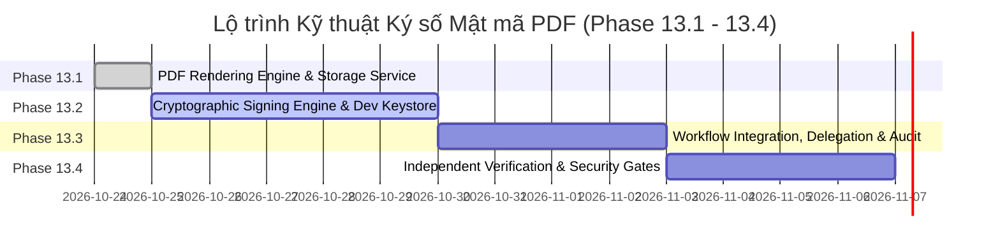

# KẾ HOẠCH TRIỂN KHAI HỆ THỐNG KÝ SỐ MẬT MÃ PDF (PHASES 13.1 — 13.4)
*Dự án: Trình Ký Online Nội Bộ Doanh Nghiệp / Tập Đoàn*  
*Giai đoạn: Phase 13.1 — PDF Rendering Engine & Secure Artifact Storage*  
*Trạng thái: PHASE 13.1 COMPLETED — SẴN SÀNG KÍCH HOẠT PHASE 13.2*

---

## 1. TỔNG QUAN LỘ TRÌNH 4 GIAI ĐOẠN (ROADMAP OVERVIEW)



| Giai đoạn | Tên nhiệm vụ chính | Trọng tâm bàn giao kỹ thuật | Tiêu chí hoàn thành cốt lõi (Definition of Done) | Trạng thái |
| :--- | :--- | :--- | :--- | :--- |
| **Phase 13.1** | **PDF Rendering Engine & Artifact Storage Service** | 1. Xây dựng dịch vụ kết xuất PDF bất biến từ form snapshot.<br/>2. Xây dựng module lưu trữ `StorageService` với tenant isolation.<br/>3. Tạo bảng lưu trữ nhị phân và mã băm SHA-256. | - Sinh được PDF A4 chuẩn tiếng Việt từ `DocumentVersion`.<br/>- Tính và lưu đúng `rawPdfHash` khớp nhị phân 100%.<br/>- API tải file có phân quyền tenant. | **HOÀN THÀNH (100% Tests Pass)** |
| **Phase 13.2** | **Cryptographic Signing Engine & Dev Keystore** | 1. Tích hợp `pdf-lib` + `@node-signpdf` + `@peculiar/x509`.<br/>2. Triển khai `DevLocalKeystoreProvider` (PKCS#12 AES-256).<br/>3. Thực hiện chèn ByteRange và CMS detached signature. | - Ký thành công chữ ký số PAdES B-B trên tệp PDF.<br/>- Adobe Acrobat Reader nhận diện chữ ký hợp lệ.<br/>- Không rò rỉ khóa riêng ra ngoài RAM. |
| **Phase 13.3** | **Workflow Integration, Multi-Signer & Delegation** | 1. Tích hợp ký số vào `WorkflowOrchestrator` và FSM.<br/>2. Hỗ trợ Incremental Updates cho quy trình nhiều người ký.<br/>3. Liên kết chứng thư người ký thực tế với chính sách ủy quyền. | - Phê duyệt bước sinh đúng chữ ký số tương ứng.<br/>- Chữ ký sau không làm hỏng chữ ký trước.<br/>- Bản ghi audit liên kết `actualActor` + `delegator` + `certId`. |
| **Phase 13.4** | **Independent Verification, CLI Verifier & Security Gates** | 1. Xây dựng API và CLI kiểm tra tính toàn vẹn độc lập.<br/>2. Kiểm thử tấn công sửa đổi byte, replay, cross-tenant.<br/>3. Đạt 100% kiểm thử hồi quy và Live HTTP E2E tests. | - Phát hiện 100% tệp PDF bị sửa đổi sau ký.<br/>- Độc lập xác minh bằng OpenSSL và Adobe Reader.<br/>- Bộ test tự động PASS toàn diện. |

---

## 2. KẾ HOẠCH NÂNG CẤP CƠ SỞ DỮ LIỆU (DATABASE SCHEMA MIGRATIONS)

Cần chuẩn bị migration Prisma mới (ví dụ: `20261025_add_cryptographic_pdf_signing`):

### 2.1. Thêm Bảng mới: `digital_certificates` (Quản lý Chứng thư X.509)
```prisma
model DigitalCertificate {
  id                   String                  @id @default(uuid())
  organizationId       String
  userId               String?                 // Null nếu là con dấu điện tử chung của tổ chức
  subjectDn            String                  // Ví dụ: "CN=Nguyễn Văn A, O=Tập đoàn VinaGroup, C=VN"
  issuerDn             String                  // Ví dụ: "CN=VinaGroup Internal Root CA, O=VinaGroup"
  serialNumber         String                  // Serial duy nhất theo chuẩn X.509
  fingerprintSha256    String                  // SHA-256 fingerprint của certificate
  certificatePem       String                  @db.Text // Nội dung chứng thư công khai dạng PEM
  validFrom            DateTime
  validTo              DateTime
  status               CertificateStatus       @default(ACTIVE) // ACTIVE, REVOKED, EXPIRED
  revokedAt            DateTime?
  revokedReason        String?
  keyStorageType       KeyStorageType          @default(DEV_KEYSTORE) // DEV_KEYSTORE, CLOUD_KMS, REMOTE_SMART_CA
  keyAlias             String                  // Định danh khóa trong KMS hoặc tên file keystore
  createdAt            DateTime                @default(now())
  updatedAt            DateTime                @updatedAt

  organization         Organization            @relation(fields: [organizationId], references: [id], onDelete: Cascade)
  user                 User?                   @relation(fields: [userId], references: [id], onDelete: SetNull)
  signedArtifacts      DocumentSignedArtifact[]

  @@unique([organizationId, serialNumber])
  @@index([organizationId, status])
  @@index([userId, status])
  @@map("digital_certificates")
}

enum CertificateStatus {
  ACTIVE
  REVOKED
  EXPIRED
}

enum KeyStorageType {
  DEV_KEYSTORE
  CLOUD_KMS
  REMOTE_SMART_CA
}
```

### 2.2. Thêm Bảng mới: `document_signed_artifacts` (Quản lý Tệp PDF Đã Ký)
```prisma
model DocumentSignedArtifact {
  id                    String              @id @default(uuid())
  documentId            String
  documentVersionId     String
  organizationId        String
  certificateId         String
  stepId                String?             // Null nếu là ký niêm phong hoàn tất (final sealing)
  signedByUserId        String              // Người thực tế ký
  isDelegated           Boolean             @default(false)
  delegatedFromUserId   String?
  delegationPolicyId    String?
  
  // Mô hình 3-Tier Hash
  formDataHash          String              // SHA-256 của JSON form data
  rawPdfHash            String              // SHA-256 của PDF gốc chưa ký
  signedPdfHash         String              // SHA-256 của PDF nhị phân cuối cùng
  
  storageProvider       String              @default("LOCAL_DISK") // LOCAL_DISK, S3
  storagePath           String              // Đường dẫn tệp trên storage
  fileSizeBytes         Int
  
  // Siêu dữ liệu chuẩn PAdES
  byteRange             Int[]               // Mảng 4 số nguyên biểu diễn [offset1, len1, offset2, len2]
  signatureFieldName    String              // Tên form field (ví dụ: "Signature_Step1")
  signingTime           DateTime            @default(now())
  hasTimestamp          Boolean             @default(false)
  timestampToken        Bytes?              // Dấu thời gian RFC 3161 (nếu có)
  
  createdAt             DateTime            @default(now())

  document              Document            @relation(fields: [documentId], references: [id], onDelete: Cascade)
  documentVersion       DocumentVersion     @relation(fields: [documentVersionId], references: [id], onDelete: Cascade)
  certificate           DigitalCertificate  @relation(fields: [certificateId], references: [id], onDelete: Restrict)

  @@index([documentId, documentVersionId])
  @@index([signedPdfHash])
  @@map("document_signed_artifacts")
}
```

### 2.3. Bổ sung trường trong Bảng `DocumentVersion`
```prisma
// Trong model DocumentVersion:
rawPdfPath            String?             // Đường dẫn PDF gốc chưa ký
rawPdfHash            String?             // SHA-256 của PDF gốc
currentSignedPdfPath  String?             // Đường dẫn PDF ký số mới nhất
currentSignedPdfHash  String?             // SHA-256 của PDF ký số mới nhất
```

---

## 3. THIẾT KẾ GIAO DIỆN HỢP ĐỒNG API (API CONTRACT SPECIFICATIONS)

Các API mới được thiết kế theo chuẩn bảo mật và tính nhất quán của hệ thống:

### 3.1. API Yêu cầu Ký số Văn bản
- **Endpoint:** `POST /api/documents/:id/sign`
- **Quyền hạn:** `USER` (được phân công trong bước hiện tại hoặc có ủy quyền hợp lệ) hoặc `ADMIN` (ký niêm phong công ty).
- **Header:** `Authorization: Bearer <JWT>`, `Idempotency-Key: <UUID>`
- **Request Body:**
  ```json
  {
    "stepId": "0e1c2a3b-4d5e-6f7a-8b9c-0d1e2f3a4b5c",
    "certificateId": "1a2b3c4d-5e6f-7a8b-9c0d-1e2f3a4b5c6d",
    "signatureType": "CRYPTOGRAPHIC_PADES",
    "visualSignaturePlacement": {
      "page": 1,
      "x": 350,
      "y": 150,
      "width": 120,
      "height": 50,
      "imageUrl": "/signatures/userA.png"
    },
    "reason": "Phê duyệt tờ trình mua sắm máy tính làm việc"
  }
  ```
- **Response (200 OK):**
  ```json
  {
    "success": true,
    "data": {
      "artifactId": "9f8e7d6c-5b4a-3f2e-1d0c-9b8a7f6e5d4c",
      "documentId": "11111111-2222-3333-4444-555555555555",
      "versionNumber": 1,
      "signedPdfHash": "a3b4c5d6e7f8a9b0c1d2e3f4a5b6c7d8e9f0a1b2c3d4e5f6a7b8c9d0e1f2a3b4",
      "signedAt": "2026-10-25T10:00:00.000Z",
      "downloadUrl": "/api/documents/11111111-2222-3333-4444-555555555555/signed-pdf"
    }
  }
  ```

### 3.2. API Tải tệp PDF Đã Ký (Secure Download Endpoint)
- **Endpoint:** `GET /api/documents/:id/signed-pdf`
- **Query Params:** `?version=1` (Mặc định tải phiên bản ký mới nhất)
- **Quyền hạn:** Mọi người dùng thuộc cùng `organizationId` có quyền xem hồ sơ; hoặc `SUPER_ADMIN`.
- **Response Headers:**
  - `Content-Type: application/pdf`
  - `Content-Disposition: attachment; filename="ToTrinh_001_signed.pdf"`
  - `X-Signed-Pdf-Hash: a3b4c5...`
  - `Cache-Control: private, no-transform, max-age=3600`

### 3.3. API Xác minh Độc lập Tệp PDF (Independent Verification Endpoint)
- **Endpoint:** `POST /api/verify/pdf`
- **Quyền hạn:** Public (Không yêu cầu JWT) hoặc Internal (Có JWT để nhận thêm thông tin bối cảnh nghiệp vụ).
- **Request:** `multipart/form-data` chứa file `file: <binary_pdf>`
- **Response (200 OK):**
  ```json
  {
    "success": true,
    "data": {
      "fileName": "ToTrinh_001_signed.pdf",
      "fileSizeBytes": 245820,
      "sha256Hash": "a3b4c5d6e7f8a9b0c1d2e3f4a5b6c7d8e9f0a1b2c3d4e5f6a7b8c9d0e1f2a3b4",
      "signaturesCount": 1,
      "isTampered": false,
      "signatures": [
        {
          "signatureName": "Signature_Step1",
          "signerSubject": "CN=Nguyễn Văn A, O=Tập đoàn VinaGroup, C=VN",
          "issuer": "CN=VinaGroup Internal Root CA, O=VinaGroup",
          "serialNumber": "5F3A89BC1200E4",
          "signingTime": "2026-10-25T10:00:00.000Z",
          "isDigestValid": true,
          "isCertificateValid": true,
          "certificateStatus": "ACTIVE",
          "hasTrustedTimestamp": false,
          "byteRange": [0, 84320, 100704, 145116]
        }
      ],
      "overallStatus": "VALID" // VALID, TAMPERED, EXPIRED_CERT, UNTRUSTED_CA
    }
  }
  ```

### 3.4. API Quản lý Danh mục Chứng thư số
- **`GET /api/certificates`**: Danh sách chứng thư thuộc công ty (ADMIN xem toàn bộ, USER xem chứng thư cá nhân).
- **`POST /api/certificates`**: Nạp chứng thư mới (chỉ ADMIN).
- **`POST /api/certificates/:id/revoke`**: Thu hồi chứng thư khi bị lộ hoặc nhân sự nghỉ việc (chỉ ADMIN).

---

## 4. CHIẾN LƯỢC KIỂM THỬ VÀ TIÊU CHÍ PASS/FAIL CỤ THỂ

Bộ kiểm thử của Phase 13 được tổ chức thành 4 cấp độ:

```
apps/api/test/
├── signing/
│   ├── pdf-generator.spec.ts              # Unit test: Render HTML -> PDF
│   ├── pdf-signer.spec.ts                 # Unit test: ByteRange, CMS Injection
│   ├── dev-keystore-provider.spec.ts      # Unit test: Key extraction, signature math
│   ├── pdf-verifier.spec.ts               # Unit test: Tamper detection, hash mismatch
│   └── signing-orchestrator.spec.ts       # Unit test: Concurrency, OCC, Idempotency
├── signing-postgresql.integration.spec.ts  # Integration test: DB transaction, rollback, audit
├── e2e-http-live.ts                       # Live HTTP test: Flow ký duyệt thực tế
└── tools/
    └── external-verify-runner.ts          # External tool: Dùng OpenSSL / PDF-Lib verifier độc lập
```

### Tiêu chí Đánh giá Chi tiết (Pass/Fail Test Gates):

| Mã Test | Mô tả kịch bản kiểm thử | Hành vi kỳ vọng (Expected Result) | Tiêu chí Đạt (Pass Criteria) |
| :--- | :--- | :--- | :--- |
| **TEST-01** | **Xác minh chữ ký nguyên vẹn** | Ký số trên file PDF mẫu $\rightarrow$ Đưa qua bộ xác minh nội bộ và công cụ OpenSSL. | Cả 2 công cụ kết luận `VALID`, mã băm khớp 100%, không có cảnh báo lỗi. |
| **TEST-02** | **Phát hiện can thiệp nhị phân (Tamper Detection)** | Sửa đổi 1 byte ngẫu nhiên trong vùng byteRange của file PDF đã ký (mô phỏng kẻ gian sửa số tiền). | Verifier báo lỗi ngay lập tức: `isTampered: true`, `isDigestValid: false`, `overallStatus: TAMPERED`. |
| **TEST-03** | **Kiểm tra chứng thư hết hạn / bị thu hồi** | Dùng chứng thư có `validTo < now()` hoặc đã bị `REVOKED` để gọi API ký. | API từ chối với HTTP `400 Bad Request` hoặc `403 Forbidden`; không tệp PDF nào được ký. |
| **TEST-04** | **Phòng chống PDF Parser Crash (DOS)** | Gửi tệp PDF hỏng (thiếu EOF, đệ quy tham chiếu, tệp rác 50MB). | API trả về `400 VALIDATION_ERROR` trong vòng < 2 giây, tiến trình Node.js không bị crash. |
| **TEST-05** | **Bảo mật Cách ly Đa Doanh nghiệp (Tenant Isolation)** | User Công ty A cố tình tải PDF đã ký hoặc dùng chứng thư số của Công ty B. | Hệ thống từ chối `403 FORBIDDEN` tuyệt đối; không lộ đường dẫn storage hay metadata của Công ty B. |
| **TEST-06** | **Chống Ký lặp do Tương tranh (Concurrency Test)** | Gửi đồng thời 10 request ký (`Promise.all`) với cùng `idempotencyKey` và token. | Chỉ có duy nhất 1 chữ ký được sinh ra; 9 request còn lại nhận kết quả thành công mà không sinh thêm file hay bản ghi mới. |
| **TEST-07** | **Giao dịch Hai pha và Xử lý Lỗi Bất thường (Recovery)** | Giả lập lỗi DB ngắt kết nối đúng thời điểm sau khi file đã tải lên Storage. | Hệ thống rollback transaction, kích hoạt xóa file rác trên storage; không xuất hiện file mồ côi không có metadata. |
| **TEST-08** | **Bảo toàn Chữ ký khi Ký Nhiều Cấp (Incremental Updates)** | Người 1 ký $\rightarrow$ Người 2 ký $\rightarrow$ Mở file kiểm tra cả 2 chữ ký. | Cả 2 chữ ký đều hiển thị `VALID` trên Adobe Acrobat; chữ ký 1 không bị báo hỏng bởi chữ ký 2. |
| **TEST-09** | **Liên kết Kiểm toán Đầy đủ (Audit Trail Completeness)** | Ký duyệt thông qua ủy quyền (Delegation). | Bản ghi audit và tệp PDF ghi nhận đầy đủ 4 trường: `actualActor`, `delegator`, `delegationPolicyId`, `certificateSubjectDn`. |
| **TEST-10** | **Không Hồi quy Hệ thống (Zero Regression)** | Chạy toàn bộ 235 unit tests và 107 PostgreSQL integration tests hiện có. | 100% tests hiện có đều PASS, không suy giảm hiệu năng hay làm hỏng luồng workflow hiện hành. |

---

## 5. CÁC VẤN ĐỀ CHƯA GIẢI QUYẾT & GIẢI PHÁP TƯƠNG LAI (OPEN ISSUES & FUTURE ENHANCEMENTS)

1. **Kết nối trực tiếp CA Quốc gia / SmartCA tại Việt Nam:**
   - *Hiện trạng*: Chưa có hợp đồng thương mại với VNPT, Viettel, hay FPT để có API Key và chứng thư số công cộng thật.
   - *Giải pháp*: Trong Phase 13, sử dụng `DevLocalKeystoreProvider` với bộ chứng thư tự sinh chuẩn X.509 RFC 5280 để hoàn thiện 100% logic kỹ thuật. Khi có hợp đồng thương mại, chỉ cần cắm `RemoteSmartCaProvider` vào interface `ISigningKeyProvider` mà không phải viết lại core.
2. **Máy chủ Cấp Dấu Thời gian (TSA - Time Stamping Authority):**
   - *Hiện trạng*: Chưa đăng ký gói dịch vụ TSA trả phí RFC 3161.
   - *Giải pháp*: Trong Phase 13.2 - 13.3, sử dụng TSA miễn phí của các tổ chức kiểm thử quốc tế (ví dụ: `http://timestamp.digicert.com` hoặc `http://freetsa.org`) kết hợp chế độ Soft-fail nếu mất kết nối Internet.
3. **Hiển thị trực quan chữ ký trên Web (Client-side PDF Viewer):**
   - *Hiện trạng*: Giao diện web Next.js đang hiển thị form HTML tĩnh.
   - *Giải pháp*: Bổ sung component xem trước PDF (sử dụng `pdfjs-dist` hoặc PDF viewer tích hợp) có đánh dấu vị trí các ô chữ ký số và trạng thái xác minh trực quan trên giao diện tài liệu.

---

## 6. QUYẾT ĐỊNH GO / NO-GO CHO PHASE 13.2.2 — CMS/PDF SIGNING ENGINE

Dựa trên kết quả triển khai và kiểm thử thực tế của Phase 13.1 và Phase 13.2.1:

### 6.1. Đánh giá Điều kiện Tiên quyết:
1. **Nền tảng Quản lý Khóa (`ISigningKeyProvider`)**: Đã hoàn thành, phân định rõ ràng ngữ nghĩa `signData` và `signDigest`, không bao giờ export private key $\rightarrow$ **ĐẠT (PASS)**.
2. **Local Keystore Bảo mật (`DevLocalKeystoreProvider`)**: Lưu trữ ngoài web root, kiểm tra cặp khóa tương ứng với chứng thư, path traversal regex, và mã hóa AES-256-CBC $\rightarrow$ **ĐẠT (PASS)**.
3. **Danh mục Chứng thư X.509 (`DigitalCertificate`)**: Quản lý vòng đời (`ACTIVE`, `REVOKED`, `EXPIRED`), cô lập đa doanh nghiệp (Tenant Isolation), bảo vệ quyền riêng tư cá nhân và audit log đầy đủ $\rightarrow$ **ĐẠT (PASS)**.
4. **Adapter cho Remote Signing / KMS**: Thiết kế sẵn `CloudKmsSigningProvider` và `RemoteSigningProviderOptions` $\rightarrow$ **ĐẠT (PASS)**.
5. **Kiểm thử Toàn diện**:
   - 180 API Unit Tests (15 suites) PASS 100%.
   - 119 PostgreSQL Integration Tests (10 suites) PASS 100%.
   - 70/70 Live HTTP E2E Tests (100%) PASS trên server NestJS và CSDL PostgreSQL vật lý.
   - Không có hồi quy (Zero Regression) trên toàn bộ monorepo.
6. **Ranh giới Thực thi Rõ ràng**: Chưa tuyên bố có chữ ký số PDF PAdES trong Phase 13.2.1; không tự động ký khi văn bản `APPROVED`.

### **KẾT LUẬN CHO PHASE 13.2.2: ĐÃ HOÀN THÀNH XUẤT SẮC (COMPLETED)**

---

## 7. BÁO CÁO NGHIỆM THU PHASE 13.2.2 — CMS/PDF SIGNING ENGINE

Dựa trên kết quả triển khai và kiểm thử thực tế của Phase 13.2.2:

### 7.1. Đánh giá Tiêu chí Đạt (Pass Criteria):
1. **CMS Detached Signature Generator (`CmsSignatureBuilder`)**: Đạt chuẩn RFC 5652 `signedData`, `id-data` không chứa `eContent`, sắp xếp từ điển SignedAttributes, băm 32-byte digest và ký qua `ISigningKeyProvider.signDigest`. Xác minh thành công 100% bằng OpenSSL CLI với cờ `-binary`. $\rightarrow$ **ĐẠT (PASS)**.
2. **PDF Signature Adapter (`PdfSignatureAdapter`)**: Cấp phát `/Type /Sig`, `/Filter /Adobe.PPKLite`, `/SubFilter /adbe.pkcs7.detached`, vùng đệm `/Contents` và tính toán `/ByteRange` nhị phân chính xác. Chống tràn placeholder an toàn (Fail-safe overflow check). $\rightarrow$ **ĐẠT (PASS)**.
3. **Trình Xác minh Độc lập (`PdfSignatureVerifier`)**: Tự động giải mã ByteRange, băm lại toàn bộ byte được ký, trích xuất `messageDigest` và xác minh chữ ký RSA bằng khóa công khai X.509 nhúng. Phát hiện can thiệp nhị phân cấp byte (Tamper Detection) tức thì. $\rightarrow$ **ĐẠT (PASS)**.
4. **Điều phối Ký an toàn (`PdfSigningService`)**: Sử dụng PostgreSQL Advisory Lock chống ký đồng thời, xác minh tệp chưa ký khớp `rawPdfHash`, kiểm tra trạng thái chứng thư (`ACTIVE`, còn hạn, sở hữu hợp lệ), thực hiện self-verification bắt buộc trước khi ghi storage và commit CSDL (Fail-closed). $\rightarrow$ **ĐẠT (PASS)**.
5. **Bảo toàn Tệp & Phân định Rõ ràng 3 Mã Băm**:
   - `formDataHash`: Hash cấu trúc dữ liệu biểu mẫu JSON.
   - `rawPdfHash`: SHA-256 của tệp PDF gốc chưa ký `OFFICIAL_UNSIGNED` (bảo toàn 100%, không bao giờ bị ghi đè).
   - `signedPdfHash`: SHA-256 của toàn bộ tệp PDF đã ký số `SIGNED_PDF`.
6. **Kiểm thử Toàn diện**:
   - **199/199 Unit Tests** (19 suites) PASS 100%.
   - **126/126 PostgreSQL Integration Tests** (11 suites) PASS 100%.
   - **80/80 Live HTTP E2E Tests** (100%) PASS trên server NestJS và PostgreSQL vật lý.
   - **OpenSSL 3.5.7 CLI Detached Verification**: `CMS Verification successful`.
   - **Zero Regression**: Shared (47/47), Web (46/46), Monorepo build PASS 100%.
7. **Ranh giới Kỹ thuật**: Chưa có RFC 3161 TSA; chưa triển khai DSS/VRI/LTV; chưa tự động ký khi văn bản chuyển sang `APPROVED`.

### **KẾT LUẬN CUỐI CÙNG: GO CHO PHASE 13.3**
Hệ thống chính thức đủ điều kiện và sẵn sàng bước vào **Phase 13.3: Dịch vụ Dấu thời gian Tin cậy RFC 3161 TSA & Cổng Xác minh Chữ ký Số Độc lập (Public Verification Portal)**.
