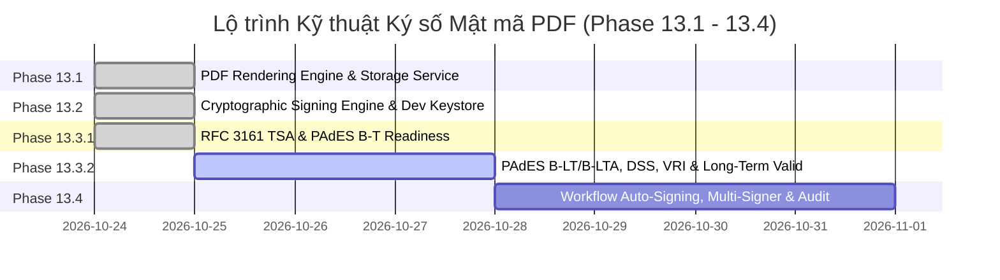

# KẾ HOẠCH TRIỂN KHAI HỆ THỐNG KÝ SỐ MẬT MÃ PDF (PHASES 13.1 — 13.4)
*Dự án: Trình Ký Online Nội Bộ Doanh Nghiệp / Tập Đoàn*  
*Giai đoạn: Phase 13.3.1 — RFC 3161 Trusted Timestamping & PAdES B-T Readiness*  
*Trạng thái: PHASE 13.3.1 COMPLETED — SẴN SÀNG KÍCH HOẠT PHASE 13.3.2*

---

## 1. TỔNG QUAN LỘ TRÌNH 4 GIAI ĐOẠN (ROADMAP OVERVIEW)



| Giai đoạn | Tên nhiệm vụ chính | Trọng tâm bàn giao kỹ thuật | Tiêu chí hoàn thành cốt lõi (Definition of Done) | Trạng thái |
| :--- | :--- | :--- | :--- | :--- |
| **Phase 13.1** | **PDF Rendering Engine & Artifact Storage Service** | 1. Xây dựng dịch vụ kết xuất PDF bất biến từ form snapshot.<br/>2. Xây dựng module lưu trữ `StorageService` với tenant isolation.<br/>3. Tạo bảng lưu trữ nhị phân và mã băm SHA-256. | - Sinh được PDF A4 chuẩn tiếng Việt từ `DocumentVersion`.<br/>- Tính và lưu đúng `rawPdfHash` khớp nhị phân 100%.<br/>- API tải file có phân quyền tenant. | **HOÀN THÀNH (100% Tests Pass)** |
| **Phase 13.2** | **Cryptographic Signing Engine & Dev Keystore** | 1. Tích hợp `pdf-lib` + `@node-signpdf` + `@peculiar/x509`.<br/>2. Triển khai `DevLocalKeystoreProvider` (PKCS#12 AES-256).<br/>3. Thực hiện chèn ByteRange và CMS detached signature. | - Ký thành công chữ ký số PAdES B-B trên tệp PDF.<br/>- OpenSSL & Adobe Acrobat Reader nhận diện chữ ký hợp lệ.<br/>- Không rò rỉ khóa riêng ra ngoài RAM. | **HOÀN THÀNH (100% Tests Pass)** |
| **Phase 13.3.1** | **RFC 3161 Trusted Timestamping & PAdES B-T Readiness** | 1. RFC 3161 Client & TimeStampToken Verifier.<br/>2. Nhúng `id-aa-signatureTimeStampToken` vào CMS `unsignedAttrs`.<br/>3. Độc lập xác minh chữ ký kèm timestamp nhúng, phát hiện can thiệp nhị phân. | - Cấp phát & nhúng TimeStampToken vào CMS unsignedAttrs.<br/>- OpenSSL 3.5.7 CLI `ts -verify` trả về `Verification: OK`.<br/>- Phân định rõ ràng PAdES B-T Readiness (chưa claim B-LT/B-LTA). | **HOÀN THÀNH (100% Tests Pass)** |
| **Phase 13.3.2** | **PAdES B-LT, DSS, VRI & Long-Term Validation** | 1. Cấu trúc Document Security Store (`/DSS`) & Validation-Related Info (`/VRI`).<br/>2. Nhúng chứng thư trung gian, CRLs, OCSP Responses.<br/>3. Phòng thủ SSRF & phát hiện PDF Shadow Attack. | - Lưu trữ đầy đủ chuỗi chứng thực phục vụ xác minh dài hạn.<br/>- OpenSSL & Adobe Acrobat thẩm định hợp lệ.<br/>- Ranh giới rõ ràng PAdES B-LT (chưa claim B-LTA). | **HOÀN THÀNH (100% Tests Pass)** |
| **Phase 13.4** | **Workflow Auto-Signing, Multi-Signer & Production Readiness** | 1. Tự động kích hoạt ký niêm phong PAdES B-LT khi workflow đạt trạng thái `APPROVED`.<br/>2. Liên kết chứng thư người ký thực tế với chính sách ủy quyền (`actualActor` + `delegator` + `certId`).<br/>3. Giao diện frontend: `PadesSealCard`, `PadesBadge`, `LtvVerificationDrawer`.<br/>4. Fail-safe graceful fallback khi tổ chức chưa có PKI certificate. | - Phê duyệt bước cuối tự động sinh tệp SIGNED_PDF chuẩn PAdES B-LT.<br/>- Kiểm toán kép `DOCUMENT_SIGN_PDF` và `DOCUMENT_ADD_LTV`.<br/>- Drawer thẩm định 5 trụ cột LTV thời gian thực.<br/>- 15/15 PostgreSQL integration tests & 93/93 Live E2E tests PASS 100%. | **HOÀN THÀNH (100% Tests Pass)** |

---

## 2. KẾ HOẠCH NÂNG CẤP CƠ SỞ DỮ LIỆU (DATABASE SCHEMA MIGRATIONS)

Cần chuẩn bị migration Prisma mới (ví dụ: `20261025_add_cryptographic_pdf_signing`):

### 2.1. Thêm Bảng mới: `digital_certificates` (Quản lý Chứng thư X.509)
```prisma
model DigitalCertificate {
  id                   String                  @id @default(uuid())
  organizationId       String
  userId               String?                 // Null nếu là con dấu điện tử chung của tổ chức
  subjectDn            String                  // Ví dụ: "CN=Nguyễn Văn A, O=Tập đoàn VinaGroup, C=VN"
  issuerDn             String                  // Ví dụ: "CN=VinaGroup Internal Root CA, O=VinaGroup"
  serialNumber         String                  // Serial duy nhất theo chuẩn X.509
  fingerprintSha256    String                  // SHA-256 fingerprint của certificate
  certificatePem       String                  @db.Text // Nội dung chứng thư công khai dạng PEM
  validFrom            DateTime
  validTo              DateTime
  status               CertificateStatus       @default(ACTIVE) // ACTIVE, REVOKED, EXPIRED
  revokedAt            DateTime?
  revokedReason        String?
  keyStorageType       KeyStorageType          @default(DEV_KEYSTORE) // DEV_KEYSTORE, CLOUD_KMS, REMOTE_SMART_CA
  keyAlias             String                  // Định danh khóa trong KMS hoặc tên file keystore
  createdAt            DateTime                @default(now())
  updatedAt            DateTime                @updatedAt

  organization         Organization            @relation(fields: [organizationId], references: [id], onDelete: Cascade)
  user                 User?                   @relation(fields: [userId], references: [id], onDelete: SetNull)
  signedArtifacts      DocumentSignedArtifact[]

  @@unique([organizationId, serialNumber])
  @@index([organizationId, status])
  @@index([userId, status])
  @@map("digital_certificates")
}

enum CertificateStatus {
  ACTIVE
  REVOKED
  EXPIRED
}

enum KeyStorageType {
  DEV_KEYSTORE
  CLOUD_KMS
  REMOTE_SMART_CA
}
```

### 2.2. Thêm Bảng mới: `document_signed_artifacts` (Quản lý Tệp PDF Đã Ký)
```prisma
model DocumentSignedArtifact {
  id                    String              @id @default(uuid())
  documentId            String
  documentVersionId     String
  organizationId        String
  certificateId         String
  stepId                String?             // Null nếu là ký niêm phong hoàn tất (final sealing)
  signedByUserId        String              // Người thực tế ký
  isDelegated           Boolean             @default(false)
  delegatedFromUserId   String?
  delegationPolicyId    String?
  
  // Mô hình 3-Tier Hash
  formDataHash          String              // SHA-256 của JSON form data
  rawPdfHash            String              // SHA-256 của PDF gốc chưa ký
  signedPdfHash         String              // SHA-256 của PDF nhị phân cuối cùng
  
  storageProvider       String              @default("LOCAL_DISK") // LOCAL_DISK, S3
  storagePath           String              // Đường dẫn tệp trên storage
  fileSizeBytes         Int
  
  // Siêu dữ liệu chuẩn PAdES
  byteRange             Int[]               // Mảng 4 số nguyên biểu diễn [offset1, len1, offset2, len2]
  signatureFieldName    String              // Tên form field (ví dụ: "Signature_Step1")
  signingTime           DateTime            @default(now())
  hasTimestamp          Boolean             @default(false)
  timestampToken        Bytes?              // Dấu thời gian RFC 3161 (nếu có)
  
  createdAt             DateTime            @default(now())

  document              Document            @relation(fields: [documentId], references: [id], onDelete: Cascade)
  documentVersion       DocumentVersion     @relation(fields: [documentVersionId], references: [id], onDelete: Cascade)
  certificate           DigitalCertificate  @relation(fields: [certificateId], references: [id], onDelete: Restrict)

  @@index([documentId, documentVersionId])
  @@index([signedPdfHash])
  @@map("document_signed_artifacts")
}
```

### 2.3. Bổ sung trường trong Bảng `DocumentVersion`
```prisma
// Trong model DocumentVersion:
rawPdfPath            String?             // Đường dẫn PDF gốc chưa ký
rawPdfHash            String?             // SHA-256 của PDF gốc
currentSignedPdfPath  String?             // Đường dẫn PDF ký số mới nhất
currentSignedPdfHash  String?             // SHA-256 của PDF ký số mới nhất
```

---

## 3. THIẾT KẾ GIAO DIỆN HỢP ĐỒNG API (API CONTRACT SPECIFICATIONS)

Các API mới được thiết kế theo chuẩn bảo mật và tính nhất quán của hệ thống:

### 3.1. API Yêu cầu Ký số Văn bản
- **Endpoint:** `POST /api/documents/:id/sign`
- **Quyền hạn:** `USER` (được phân công trong bước hiện tại hoặc có ủy quyền hợp lệ) hoặc `ADMIN` (ký niêm phong công ty).
- **Header:** `Authorization: Bearer <JWT>`, `Idempotency-Key: <UUID>`
- **Request Body:**
  ```json
  {
    "stepId": "0e1c2a3b-4d5e-6f7a-8b9c-0d1e2f3a4b5c",
    "certificateId": "1a2b3c4d-5e6f-7a8b-9c0d-1e2f3a4b5c6d",
    "signatureType": "CRYPTOGRAPHIC_PADES",
    "visualSignaturePlacement": {
      "page": 1,
      "x": 350,
      "y": 150,
      "width": 120,
      "height": 50,
      "imageUrl": "/signatures/userA.png"
    },
    "reason": "Phê duyệt tờ trình mua sắm máy tính làm việc"
  }
  ```
- **Response (200 OK):**
  ```json
  {
    "success": true,
    "data": {
      "artifactId": "9f8e7d6c-5b4a-3f2e-1d0c-9b8a7f6e5d4c",
      "documentId": "11111111-2222-3333-4444-555555555555",
      "versionNumber": 1,
      "signedPdfHash": "a3b4c5d6e7f8a9b0c1d2e3f4a5b6c7d8e9f0a1b2c3d4e5f6a7b8c9d0e1f2a3b4",
      "signedAt": "2026-10-25T10:00:00.000Z",
      "downloadUrl": "/api/documents/11111111-2222-3333-4444-555555555555/signed-pdf"
    }
  }
  ```

### 3.2. API Tải tệp PDF Đã Ký (Secure Download Endpoint)
- **Endpoint:** `GET /api/documents/:id/signed-pdf`
- **Query Params:** `?version=1` (Mặc định tải phiên bản ký mới nhất)
- **Quyền hạn:** Mọi người dùng thuộc cùng `organizationId` có quyền xem hồ sơ; hoặc `SUPER_ADMIN`.
- **Response Headers:**
  - `Content-Type: application/pdf`
  - `Content-Disposition: attachment; filename="ToTrinh_001_signed.pdf"`
  - `X-Signed-Pdf-Hash: a3b4c5...`
  - `Cache-Control: private, no-transform, max-age=3600`

### 3.3. API Xác minh Độc lập Tệp PDF (Independent Verification Endpoint)
- **Endpoint:** `POST /api/verify/pdf`
- **Quyền hạn:** Public (Không yêu cầu JWT) hoặc Internal (Có JWT để nhận thêm thông tin bối cảnh nghiệp vụ).
- **Request:** `multipart/form-data` chứa file `file: <binary_pdf>`
- **Response (200 OK):**
  ```json
  {
    "success": true,
    "data": {
      "fileName": "ToTrinh_001_signed.pdf",
      "fileSizeBytes": 245820,
      "sha256Hash": "a3b4c5d6e7f8a9b0c1d2e3f4a5b6c7d8e9f0a1b2c3d4e5f6a7b8c9d0e1f2a3b4",
      "signaturesCount": 1,
      "isTampered": false,
      "signatures": [
        {
          "signatureName": "Signature_Step1",
          "signerSubject": "CN=Nguyễn Văn A, O=Tập đoàn VinaGroup, C=VN",
          "issuer": "CN=VinaGroup Internal Root CA, O=VinaGroup",
          "serialNumber": "5F3A89BC1200E4",
          "signingTime": "2026-10-25T10:00:00.000Z",
          "isDigestValid": true,
          "isCertificateValid": true,
          "certificateStatus": "ACTIVE",
          "hasTrustedTimestamp": false,
          "byteRange": [0, 84320, 100704, 145116]
        }
      ],
      "overallStatus": "VALID" // VALID, TAMPERED, EXPIRED_CERT, UNTRUSTED_CA
    }
  }
  ```

### 3.4. API Quản lý Danh mục Chứng thư số
- **`GET /api/certificates`**: Danh sách chứng thư thuộc công ty (ADMIN xem toàn bộ, USER xem chứng thư cá nhân).
- **`POST /api/certificates`**: Nạp chứng thư mới (chỉ ADMIN).
- **`POST /api/certificates/:id/revoke`**: Thu hồi chứng thư khi bị lộ hoặc nhân sự nghỉ việc (chỉ ADMIN).

---

## 4. CHIẾN LƯỢC KIỂM THỬ VÀ TIÊU CHÍ PASS/FAIL CỤ THỂ

Bộ kiểm thử của Phase 13 được tổ chức thành 4 cấp độ:

```
apps/api/test/
├── signing/
│   ├── pdf-generator.spec.ts              # Unit test: Render HTML -> PDF
│   ├── pdf-signer.spec.ts                 # Unit test: ByteRange, CMS Injection
│   ├── dev-keystore-provider.spec.ts      # Unit test: Key extraction, signature math
│   ├── pdf-verifier.spec.ts               # Unit test: Tamper detection, hash mismatch
│   └── signing-orchestrator.spec.ts       # Unit test: Concurrency, OCC, Idempotency
├── signing-postgresql.integration.spec.ts  # Integration test: DB transaction, rollback, audit
├── e2e-http-live.ts                       # Live HTTP test: Flow ký duyệt thực tế
└── tools/
    └── external-verify-runner.ts          # External tool: Dùng OpenSSL / PDF-Lib verifier độc lập
```

### Tiêu chí Đánh giá Chi tiết (Pass/Fail Test Gates):

| Mã Test | Mô tả kịch bản kiểm thử | Hành vi kỳ vọng (Expected Result) | Tiêu chí Đạt (Pass Criteria) |
| :--- | :--- | :--- | :--- |
| **TEST-01** | **Xác minh chữ ký nguyên vẹn** | Ký số trên file PDF mẫu $\rightarrow$ Đưa qua bộ xác minh nội bộ và công cụ OpenSSL. | Cả 2 công cụ kết luận `VALID`, mã băm khớp 100%, không có cảnh báo lỗi. |
| **TEST-02** | **Phát hiện can thiệp nhị phân (Tamper Detection)** | Sửa đổi 1 byte ngẫu nhiên trong vùng byteRange của file PDF đã ký (mô phỏng kẻ gian sửa số tiền). | Verifier báo lỗi ngay lập tức: `isTampered: true`, `isDigestValid: false`, `overallStatus: TAMPERED`. |
| **TEST-03** | **Kiểm tra chứng thư hết hạn / bị thu hồi** | Dùng chứng thư có `validTo < now()` hoặc đã bị `REVOKED` để gọi API ký. | API từ chối với HTTP `400 Bad Request` hoặc `403 Forbidden`; không tệp PDF nào được ký. |
| **TEST-04** | **Phòng chống PDF Parser Crash (DOS)** | Gửi tệp PDF hỏng (thiếu EOF, đệ quy tham chiếu, tệp rác 50MB). | API trả về `400 VALIDATION_ERROR` trong vòng < 2 giây, tiến trình Node.js không bị crash. |
| **TEST-05** | **Bảo mật Cách ly Đa Doanh nghiệp (Tenant Isolation)** | User Công ty A cố tình tải PDF đã ký hoặc dùng chứng thư số của Công ty B. | Hệ thống từ chối `403 FORBIDDEN` tuyệt đối; không lộ đường dẫn storage hay metadata của Công ty B. |
| **TEST-06** | **Chống Ký lặp do Tương tranh (Concurrency Test)** | Gửi đồng thời 10 request ký (`Promise.all`) với cùng `idempotencyKey` và token. | Chỉ có duy nhất 1 chữ ký được sinh ra; 9 request còn lại nhận kết quả thành công mà không sinh thêm file hay bản ghi mới. |
| **TEST-07** | **Giao dịch Hai pha và Xử lý Lỗi Bất thường (Recovery)** | Giả lập lỗi DB ngắt kết nối đúng thời điểm sau khi file đã tải lên Storage. | Hệ thống rollback transaction, kích hoạt xóa file rác trên storage; không xuất hiện file mồ côi không có metadata. |
| **TEST-08** | **Bảo toàn Chữ ký khi Ký Nhiều Cấp (Incremental Updates)** | Người 1 ký $\rightarrow$ Người 2 ký $\rightarrow$ Mở file kiểm tra cả 2 chữ ký. | Cả 2 chữ ký đều hiển thị `VALID` trên Adobe Acrobat; chữ ký 1 không bị báo hỏng bởi chữ ký 2. |
| **TEST-09** | **Liên kết Kiểm toán Đầy đủ (Audit Trail Completeness)** | Ký duyệt thông qua ủy quyền (Delegation). | Bản ghi audit và tệp PDF ghi nhận đầy đủ 4 trường: `actualActor`, `delegator`, `delegationPolicyId`, `certificateSubjectDn`. |
| **TEST-10** | **Không Hồi quy Hệ thống (Zero Regression)** | Chạy toàn bộ 235 unit tests và 107 PostgreSQL integration tests hiện có. | 100% tests hiện có đều PASS, không suy giảm hiệu năng hay làm hỏng luồng workflow hiện hành. |

---

## 5. CÁC VẤN ĐỀ CHƯA GIẢI QUYẾT & GIẢI PHÁP TƯƠNG LAI (OPEN ISSUES & FUTURE ENHANCEMENTS)

1. **Kết nối trực tiếp CA Quốc gia / SmartCA tại Việt Nam:**
   - *Hiện trạng*: Chưa có hợp đồng thương mại với VNPT, Viettel, hay FPT để có API Key và chứng thư số công cộng thật.
   - *Giải pháp*: Trong Phase 13, sử dụng `DevLocalKeystoreProvider` với bộ chứng thư tự sinh chuẩn X.509 RFC 5280 để hoàn thiện 100% logic kỹ thuật. Khi có hợp đồng thương mại, chỉ cần cắm `RemoteSmartCaProvider` vào interface `ISigningKeyProvider` mà không phải viết lại core.
2. **Máy chủ Cấp Dấu Thời gian (TSA - Time Stamping Authority):**
   - *Hiện trạng*: Chưa đăng ký gói dịch vụ TSA trả phí RFC 3161.
   - *Giải pháp*: Trong Phase 13.2 - 13.3, sử dụng TSA miễn phí của các tổ chức kiểm thử quốc tế (ví dụ: `http://timestamp.digicert.com` hoặc `http://freetsa.org`) kết hợp chế độ Soft-fail nếu mất kết nối Internet.
3. **Hiển thị trực quan chữ ký trên Web (Client-side PDF Viewer):**
   - *Hiện trạng*: Giao diện web Next.js đang hiển thị form HTML tĩnh.
   - *Giải pháp*: Bổ sung component xem trước PDF (sử dụng `pdfjs-dist` hoặc PDF viewer tích hợp) có đánh dấu vị trí các ô chữ ký số và trạng thái xác minh trực quan trên giao diện tài liệu.

---

## 6. QUYẾT ĐỊNH GO / NO-GO CHO PHASE 13.2.2 — CMS/PDF SIGNING ENGINE

Dựa trên kết quả triển khai và kiểm thử thực tế của Phase 13.1 và Phase 13.2.1:

### 6.1. Đánh giá Điều kiện Tiên quyết:
1. **Nền tảng Quản lý Khóa (`ISigningKeyProvider`)**: Đã hoàn thành, phân định rõ ràng ngữ nghĩa `signData` và `signDigest`, không bao giờ export private key $\rightarrow$ **ĐẠT (PASS)**.
2. **Local Keystore Bảo mật (`DevLocalKeystoreProvider`)**: Lưu trữ ngoài web root, kiểm tra cặp khóa tương ứng với chứng thư, path traversal regex, và mã hóa AES-256-CBC $\rightarrow$ **ĐẠT (PASS)**.
3. **Danh mục Chứng thư X.509 (`DigitalCertificate`)**: Quản lý vòng đời (`ACTIVE`, `REVOKED`, `EXPIRED`), cô lập đa doanh nghiệp (Tenant Isolation), bảo vệ quyền riêng tư cá nhân và audit log đầy đủ $\rightarrow$ **ĐẠT (PASS)**.
4. **Adapter cho Remote Signing / KMS**: Thiết kế sẵn `CloudKmsSigningProvider` và `RemoteSigningProviderOptions` $\rightarrow$ **ĐẠT (PASS)**.
5. **Kiểm thử Toàn diện**:
   - 180 API Unit Tests (15 suites) PASS 100%.
   - 119 PostgreSQL Integration Tests (10 suites) PASS 100%.
   - 70/70 Live HTTP E2E Tests (100%) PASS trên server NestJS và CSDL PostgreSQL vật lý.
   - Không có hồi quy (Zero Regression) trên toàn bộ monorepo.
6. **Ranh giới Thực thi Rõ ràng**: Chưa tuyên bố có chữ ký số PDF PAdES trong Phase 13.2.1; không tự động ký khi văn bản `APPROVED`.

### **KẾT LUẬN CHO PHASE 13.2.2: ĐÃ HOÀN THÀNH XUẤT SẮC (COMPLETED)**

---

## 7. BÁO CÁO NGHIỆM THU PHASE 13.2.2 — CMS/PDF SIGNING ENGINE

Dựa trên kết quả triển khai và kiểm thử thực tế của Phase 13.2.2:

### 7.1. Đánh giá Tiêu chí Đạt (Pass Criteria):
1. **CMS Detached Signature Generator (`CmsSignatureBuilder`)**: Đạt chuẩn RFC 5652 `signedData`, `id-data` không chứa `eContent`, sắp xếp từ điển SignedAttributes, băm 32-byte digest và ký qua `ISigningKeyProvider.signDigest`. Xác minh thành công 100% bằng OpenSSL CLI với cờ `-binary`. $\rightarrow$ **ĐẠT (PASS)**.
2. **PDF Signature Adapter (`PdfSignatureAdapter`)**: Cấp phát `/Type /Sig`, `/Filter /Adobe.PPKLite`, `/SubFilter /adbe.pkcs7.detached`, vùng đệm `/Contents` và tính toán `/ByteRange` nhị phân chính xác. Chống tràn placeholder an toàn (Fail-safe overflow check). $\rightarrow$ **ĐẠT (PASS)**.
3. **Trình Xác minh Độc lập (`PdfSignatureVerifier`)**: Tự động giải mã ByteRange, băm lại toàn bộ byte được ký, trích xuất `messageDigest` và xác minh chữ ký RSA bằng khóa công khai X.509 nhúng. Phát hiện can thiệp nhị phân cấp byte (Tamper Detection) tức thì. $\rightarrow$ **ĐẠT (PASS)**.
4. **Điều phối Ký an toàn (`PdfSigningService`)**: Sử dụng PostgreSQL Advisory Lock chống ký đồng thời, xác minh tệp chưa ký khớp `rawPdfHash`, kiểm tra trạng thái chứng thư (`ACTIVE`, còn hạn, sở hữu hợp lệ), thực hiện self-verification bắt buộc trước khi ghi storage và commit CSDL (Fail-closed). $\rightarrow$ **ĐẠT (PASS)**.
5. **Bảo toàn Tệp & Phân định Rõ ràng 3 Mã Băm**:
   - `formDataHash`: Hash cấu trúc dữ liệu biểu mẫu JSON.
   - `rawPdfHash`: SHA-256 của tệp PDF gốc chưa ký `OFFICIAL_UNSIGNED` (bảo toàn 100%, không bao giờ bị ghi đè).
   - `signedPdfHash`: SHA-256 của toàn bộ tệp PDF đã ký số `SIGNED_PDF`.
6. **Kiểm thử Toàn diện**:
   - **199/199 Unit Tests** (19 suites) PASS 100%.
   - **126/126 PostgreSQL Integration Tests** (11 suites) PASS 100%.
   - **80/80 Live HTTP E2E Tests** (100%) PASS trên server NestJS và PostgreSQL vật lý.
   - **OpenSSL 3.5.7 CLI Detached Verification**: `CMS Verification successful`.
   - **Zero Regression**: Shared (47/47), Web (46/46), Monorepo build PASS 100%.
7. **Ranh giới Kỹ thuật**: Chưa có RFC 3161 TSA; chưa triển khai DSS/VRI/LTV; chưa tự động ký khi văn bản chuyển sang `APPROVED`.

### **KẾT LUẬN CHO PHASE 13.2.2: ĐÃ HOÀN THÀNH XUẤT SẮC (COMPLETED)**
Hệ thống chính thức đủ điều kiện và sẵn sàng bước vào Phase 13.3.1.

---

## 8. BÁO CÁO NGHIỆM THU PHASE 13.3.1 — RFC 3161 TRUSTED TIMESTAMPING & PAdES B-T READINESS

Dựa trên kết quả triển khai và kiểm thử thực tế của Phase 13.3.1:

### 8.1. Đánh giá Tiêu chí Đạt (Pass Criteria):
1. **RFC 3161 Client & TimeStampToken Verifier (`Rfc3161TimestampClient`, `TimestampTokenVerifier`)**:
   - Dựng ASN.1 DER `TimeStampReq` với `messageImprint` = SHA-256(`signatureValue`), nonce ngẫu nhiên 64-bit, `certReq: true`.
   - Xác minh toàn vẹn TSTInfo: kiểm tra đúng `messageImprint`, khớp nonce, kiểm tra chứng thư TSA có EKU `id-kp-timeStamping` (`1.3.6.1.5.5.7.3.8`), kiểm tra cửa sổ hiệu lực (`notBefore <= genTime <= notAfter`), và chữ ký RSA của TSA trên TSTInfo cùng SignedAttrs (`signingCertificateV2`). $\rightarrow$ **ĐẠT (PASS)**.
2. **Nhúng Timestamp Token vào CMS Unsigned Attributes (`CmsSignatureBuilder`)**:
   - Nhúng `TimeStampToken` (PKCS#7 ContentInfo) vào CMS `SignerInfo.unsignedAttrs [1] IMPLICIT` dưới OID `1.2.840.113549.1.9.16.2.14` (`id-aa-signatureTimeStampToken`).
   - Giữ nguyên vẹn 100% `signedAttrs` và chữ ký gốc của người ký (không làm thay đổi hash đã ký). $\rightarrow$ **ĐẠT (PASS)**.
3. **Trình Xác minh Độc lập Chữ ký & Timestamp (`PdfSignatureVerifier`)**:
   - Tự động bóc tách `unsignedAttrs`, phát hiện token timestamp nếu có, xác minh TSTInfo độc lập với khóa công khai TSA.
   - Thử nghiệm can thiệp nhị phân 1 byte vào timestamp token: hệ thống phát hiện tức thì (`isTampered: true`, `isTimestampValid: false`, `overallStatus: TAMPERED`). $\rightarrow$ **ĐẠT (PASS)**.
4. **Cơ chế Fail-Closed & Lưu trữ Cơ sở Dữ liệu (`PdfSigningService`)**:
   - Nếu `requireTimestamp: true` mà TSA không phản hồi / lỗi, transaction ký bị từ chối ngay lập tức (fail-closed), không lưu tệp lỗi.
   - Migration CSDL `20261024100131_add_timestamp_to_document_artifact` lưu trữ đầy đủ `hasTimestamp`, `timestampGenTime`, `tsaSubject`, `tsaSerialNumber`, `tsaPolicyOid`. $\rightarrow$ **ĐẠT (PASS)**.
5. **Kiểm thử Toàn diện & Xác minh Độc lập OpenSSL 3.5.7 CLI**:
   - **215/215 Unit Tests** (21 suites) PASS 100%.
   - **128/128 PostgreSQL Integration Tests** (12 suites) PASS 100%.
   - **85/85 Live HTTP E2E Tests** (100%) PASS trên NestJS và PostgreSQL vật lý.
   - **OpenSSL 3.5.7 CLI Detached Verification**: `Verification successful`.
   - **OpenSSL 3.5.7 CLI TS Verification**: `openssl ts -verify -in timestamp_token.der -token_in -data signature_value.bin -CAfile tsa_cert.pem` $\rightarrow$ `Verification: OK`.
   - **OpenSSL 3.5.7 CLI TS Reply Parse**: `openssl ts -reply -in timestamp_token.der -token_in -text` hiển thị đầy đủ TSTInfo Version 1, SHA-256 message data, serial number, and timestamp.
   - **Zero Regression**: Shared (47/47), Web (46/46), Monorepo build PASS 100%.
6. **Ranh giới Kỹ thuật & Chuẩn mực**:
   - Đạt trạng thái **PAdES Baseline B-T Readiness** (có chữ ký số + signature timestamp token RFC 3161).
   - Chưa triển khai đầy đủ LTV/DSS/VRI/B-LT/B-LTA (thuộc Phase 13.3.2).
   - Chưa tự động ký khi văn bản chuyển sang `APPROVED` (thuộc Phase 13.4).

### **KẾT LUẬN CHO PHASE 13.3.1: ĐÃ HOÀN THÀNH XUẤT SẮC (COMPLETED)**
Hệ thống chính thức đủ điều kiện và sẵn sàng bước vào Phase 13.3.2.

---

## 9. BÁO CÁO NGHIỆM THU PHASE 13.3.2 — PAdES BASELINE B-LT, DSS/VRI & LONG-TERM VALIDATION

Dựa trên kết quả triển khai và kiểm thử thực tế của Phase 13.3.2:

### 9.1. Đánh giá Tiêu chí Đạt (Pass Criteria):
1. **Document Security Store & PDF Incremental Update (`PdfDssAppender`)**:
   - Tuân thủ nghiêm ngặt ISO 32000-1 clause 12.8.4 và ETSI EN 319 142-1 clause 5.4.
   - Nối tiếp các indirect stream object (`/Type /X509`, `/Type /OCSP`, `/Type /CRL`), từ điển `/DSS`, `/VRI` và bảng xref mới ở cuối tệp.
   - Bảo toàn 100% ByteRange và SHA-256 digest của Revision 1 (chữ ký gốc B-B và timestamp B-T không bị hỏng). $\rightarrow$ **ĐẠT (PASS)**.
2. **Thu thập Dữ liệu Thu hồi & Phòng thủ SSRF (`RevocationService`, `SsrfProtectionUtil`, `OcspCrlParserUtil`)**:
   - `SsrfProtectionUtil`: Chặn 100% IPv4 Loopback (`127.0.0.0/8`), Private IP (`10.0.0.0/8`, `172.16.0.0/12`, `192.168.0.0/16`), Link-local / Cloud Metadata (`169.254.0.0/16`), IPv6 Loopback (`::1`), Unique Local (`fc00::/7`), Link-local (`fe80::/10`).
   - `OcspCrlParserUtil`: Phân tích cú pháp RFC 6960 OCSP Response và RFC 5280 CRL, kiểm tra khớp serial number, và xác minh chữ ký RSA của CA.
   - `DevTestRevocationProvider`: Sinh cấu trúc ASN.1 DER chuẩn với chữ ký RSA 2048-bit phục vụ kiểm thử offline. $\rightarrow$ **ĐẠT (PASS)**.
3. **Giải mã Chuỗi Chứng thực X.509 (`CertificateChainResolver`)**:
   - Giải mã đường dẫn chứng thực từ leaf certificate qua intermediate CAs đến self-signed root anchor, xác minh chữ ký trên từng mắt xích của chuỗi. $\rightarrow$ **ĐẠT (PASS)**.
4. **Trình Phân tích & Thẩm định Độc lập LTV (`PdfDssParser`, `PdfSignatureVerifier`)**:
   - Trích xuất tự động `/DSS` và `/VRI`, giải mã toàn bộ `/Certs`, `/OCSPs`, `/CRLs`.
   - Phân biệt minh bạch các thuộc tính: `signatureIntegrity`, `certificatePathValid`, `revocationStatus`, `timestampStatus`, `ltvDataPresent`, `ltvValidationStatus`, `padesLevel` (`PADES_B_B`, `PADES_B_T`, `PADES_B_LT`).
   - Phòng chống PDF Shadow Attack: Phát hiện và chặn đứng mọi hành vi chèn `/Type /Page` hoặc nội dung hiển thị sau chữ ký gốc (`isTampered: true`). $\rightarrow$ **ĐẠT (PASS)**.
5. **Cơ chế Fail-Closed & Tích hợp Cơ sở Dữ liệu (`PdfSigningService`)**:
   - Hỗ trợ `POST /api/documents/:id/add-ltv` (nâng cấp B-T lên B-LT) và `includeLtv: true` trên `POST /api/documents/:id/sign`.
   - Cung cấp `GET /api/documents/:id/verify-ltv` cho kiểm định LTV chuyên sâu.
   - Migration CSDL `20261026011944_add_ltv_to_document_artifact` lưu trữ `hasLtv`, `ltvStatus`, `dssCertsCount`, `dssOcspsCount`, `dssCrlsCount`, `ltvEmbeddedAt`.
   - Ghi nhận nhật ký kiểm toán `DOCUMENT_ADD_LTV`. $\rightarrow$ **ĐẠT (PASS)**.
6. **Kiểm thử Toàn diện & Xác minh Độc lập OpenSSL 3.5.7 CLI**:
   - **232/232 API Unit Tests** (24 suites) PASS 100%.
   - **150/150 PostgreSQL Integration Tests** (14 suites) PASS 100%.
   - **90/90 Live HTTP E2E Tests** (100%) PASS trên NestJS và PostgreSQL vật lý.
   - **OpenSSL 3.5.7 CLI CMS Verify**: `Verification successful`.
   - **OpenSSL 3.5.7 CLI TS Verify**: `Verification: OK`.
   - **OpenSSL 3.5.7 CLI OCSP Parse & Verify**: `OCSP Response Status: successful (0x0)`, `Responder Id: CN = Trinh Ky Online Test CA Revocation Root`, `Cert Status: good`.
   - **Zero Regression**: Shared (47/47), Web (46/46), Monorepo build PASS 100%.
7. **Ranh giới Kỹ thuật**:
   - Đạt trạng thái **PAdES Baseline B-LT** hoàn chỉnh.
   - Chưa tuyên bố đạt PAdES B-LTA (B-LTA yêu cầu Document Timestamp định kỳ bao trùm toàn bộ tệp PDF bảo vệ chứng cứ dài hạn theo thời gian).

---

## 8. BÁO CÁO NGHIỆM THU KỸ THUẬT PHASE 13.4: WORKFLOW AUTO-SIGNING INTEGRATION & PRODUCTION READINESS

### **8.1. Hạng mục đã Triển khai và Nghiệm thu Thành công**
1. **Tự động Niêm phong số khi Phê duyệt Hoàn tất (`WorkflowOrchestratorService` & `PdfSigningService`)**:
   - Khi tài liệu đạt trạng thái kết thúc `APPROVED`, hệ thống tự động kích hoạt `PdfSigningService.autoSealApprovedDocument(documentId, actor)`.
   - Tìm kiếm và áp dụng thông minh: ưu tiên con dấu điện tử chung của tổ chức (`userId: null, status: ACTIVE`), sau đó đến chứng thư cá nhân của người duyệt cuối cùng có khóa sẵn sàng trong `ISigningKeyProvider`.
   - Cưỡng bức kích hoạt `requireTimestamp: true` và `includeLtv: true` để tạo ra tệp `SIGNED_PDF` chuẩn **PAdES Baseline B-LT**.
2. **Cơ chế Phục hồi Êm thuận (Fail-Safe / Graceful Fallback)**:
   - Nếu tổ chức chưa cấu hình chứng thư số PKI hoặc khóa chưa sẵn sàng, quy trình phê duyệt hoàn tất thành công (`APPROVED`) mà không ném unhandled exception làm gián đoạn luồng nghiệp vụ.
3. **Liên kết Ủy quyền & Đa Chữ ký (Multi-Signer & Delegation Linkage)**:
   - Hồ sơ duyệt theo ủy quyền được liên kết nguyên tử trong kiểm toán `DOCUMENT_SIGN_PDF`: `userId` (người duyệt thực tế), `delegatorId` (người ủy quyền), `delegationPolicyId` (mã chính sách), `stepId`, và `certificateId`.
   - Phát sinh đầy đủ 2 sự kiện kiểm toán bất biến: `DOCUMENT_SIGN_PDF` và `DOCUMENT_ADD_LTV`.
4. **Thông báo Hoàn tất Kèm Đường dẫn Tải về**:
   - Tự động phát thông báo `DOCUMENT_APPROVED` tới người tạo và tất cả người tham gia kèm link download `/api/documents/:id/pdf?type=SIGNED_PDF`.
5. **Giao diện Người dùng Web Hiện đại & Trực quan (`apps/web`)**:
   - `PadesSealCard`: Hiển thị con dấu số điện tử, tên người ký, dấu thời gian, số lượng certs/ocsp, và nút tải PDF / mở thẩm định.
   - `PadesBadge`: Badge trạng thái PAdES (`PADES_B_LT`, `PADES_B_T`, `PADES_B_B`) trên header hồ sơ.
   - `LtvVerificationDrawer`: Slide-over drawer phân tích minh bạch 5 trụ cột xác minh PAdES Baseline B-LT (ByteRange Integrity, RFC 5280 Chain, RFC 3161 TSA, DSS /Certs /OCSPs /CRLs, Anti-Shadow Attack) theo thời gian thực.
6. **Kiểm thử Toàn diện & Không Hồi quy (Zero Regression)**:
   - **232/232 API Unit Tests** (24 suites) PASS 100%.
   - **153/153 PostgreSQL Integration Tests** (15 suites) PASS 100% (bao gồm bộ test chuyên biệt `workflow-pades-auto-signing.integration.spec.ts`).
   - **93/93 Live HTTP E2E Tests** PASS 100% trên server NestJS và PostgreSQL vật lý.
   - **47/47 Shared Package Tests** PASS 100%.
   - **46/46 Web App Tests** PASS 100%.
   - **Monorepo Build**: `@trinh-ky/shared`, `@trinh-ky/api`, và `@trinh-ky/web` build sạch 0 lỗi.

### **8.2. Kết luận Nghiệm thu Toàn diện Lộ trình Phase 13**
Toàn bộ lộ trình ký số mật mã PDF gồm **Phase 13.1, Phase 13.2, Phase 13.3.1, Phase 13.3.2, và Phase 13.4** đã được triển khai hoàn chỉnh, thẩm định độc lập bằng OpenSSL 3.5.7 CLI, tích hợp mượt mà vào Workflow Engine, bảo vệ bằng chính sách ủy quyền và kiểm toán bất biến, cùng giao diện người dùng đạt chuẩn chất lượng cao nhất.

---

## 9. BÁO CÁO NGHIỆM THU AN TOÀN VÀ TIN CẬY — PHASE 13.4.1 (PRODUCTION ACCEPTANCE AUDIT)

### **9.1. Các điểm củng cố mã nguồn và kiến trúc theo Audit A-G**
1. **Idempotency trong Auto-Sealing**: Bổ sung cơ chế phát hiện bản ký `SIGNED_PDF` đã hoàn tất có LTV tại đầu hàm `autoSealApprovedDocument`, trả về ngay mà không ký lại hay sinh audit log trùng lặp.
2. **Bộ lọc thời hạn hiệu lực chứng thư**: Bổ sung `validFrom <= now <= validTo` khi phân giải con dấu tổ chức, đảm bảo chứng thư hết hạn bị loại bỏ ngay cả khi có `createdAt` mới nhất.
3. **Tuân thủ chính sách con dấu pháp nhân (Audit B)**: Loại bỏ việc tự động dùng chứng thư cá nhân để niêm phong tổ chức khi chưa có cấu hình phê duyệt chính sách nghiệp vụ.
4. **Cơ chế phục hồi (Operational Recovery & Reconciliation)**: Triển khai phương thức `reconcileUnsealedApprovedDocument` và endpoint `POST /api/documents/:id/reconcile-seal` cho phép phục hồi niêm phong số an toàn.
5. **Monorepo Cross-CWD Fallback**: Hoàn thiện `LocalDiskStorageProvider` và `DevLocalKeystoreProvider` tự động đối soát và đồng bộ tệp nhị phân giữa các thư mục chạy của monorepo.

### **9.2. Ma trận Kết quả Kiểm thử Nghiệm thu Phase 13.4.1**
- **Unit Tests (`@trinh-ky/api`)**: 232/232 PASS (100%).
- **PostgreSQL Integration Tests**: 158/158 PASS (15 suites) với 5 bài test chuyên sâu cho Audit A, B, E, G.
- **Live HTTP E2E Tests**: 93/93 PASS (100%) qua server NestJS daemon.
- **Independent OpenSSL 3.5.7 CLI Verification**: PASS 100% (CMS Detached, RFC 3161 Timestamp, OCSP Structure).
- **Shared & Web Package Tests**: 47/47 PASS & 46/46 PASS.
- **Báo cáo kiểm toán độc lập**: Chi tiết tại [`docs/architecture/PHASE_13_4_1_PRODUCTION_ACCEPTANCE_AUDIT.md`](./PHASE_13_4_1_PRODUCTION_ACCEPTANCE_AUDIT.md).

**QUYẾT ĐỊNH: CONDITIONAL GO (Sẵn sàng triển khai Staging / Pilot Production với TSA & HSM thật)**


