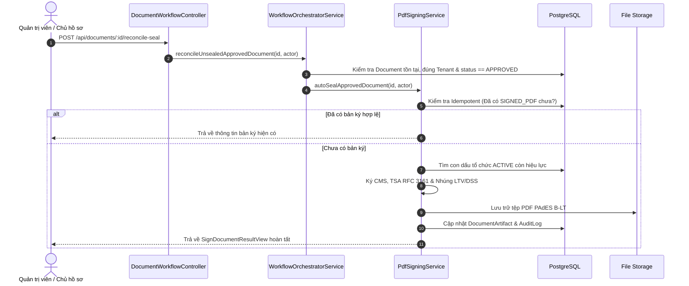

# BÁO CÁO NGHIỆM THU PRODUCTION — GIAI ĐOẠN 13.4.1
## Workflow Auto-Signing, PAdES Baseline B-LT, Security & Reliability

**Ngày thực hiện:** 26/10/2026  
**Vai trò thẩm định:** Principal Software Architect, Application Security Engineer & Digital Signature Engineer  
**Hệ thống:** Hệ thống Trình Ký Online (Multi-tenant Document Workflow & Cryptographic Digital Signing Engine)  
**Phạm vi:** Toàn bộ chuỗi nghiệp vụ từ khi Workflow chuyển `APPROVED` → Kích hoạt auto-sealing → Phân giải chứng thư/khóa → Ký CMS/PDF → Cấp dấu thời gian RFC 3161 → Bổ sung dữ liệu LTV/DSS (PAdES B-LT) → Lưu trữ Storage → Ghi nhận Audit Log → Phát thông báo → Kiểm tra tải xuống & Thẩm định mật mã độc lập (OpenSSL 3.5.7 CLI).

---

## 1. TỔNG QUAN KẾT QUẢ KIỂM THỬ THỰC TẾ

Tất cả các nhóm kiểm thử được thực thi trực tiếp trên mã nguồn và cơ sở hạ tầng thực tế (PostgreSQL 16 vật lý trên Docker và Backend NestJS Dev Server):

| Nhóm Kiểm thử | Tổng số Test | Đạt (PASS) | Lỗi (FAIL) | Bỏ qua (SKIP) | Thời gian chạy | Ghi chú |
| :--- | :---: | :---: | :---: | :---: | :---: | :--- |
| **@trinh-ky/api Unit Tests** | 232 | 232 | 0 | 0 | 5.69s | Kiểm thử cô lập từng module, adapter, verifier, parser, scheduler |
| **PostgreSQL Integration Tests** | 158 | 158 | 0 | 0 | 7.80s | 15 test suites thực thi giao dịch ACID, khóa dòng `FOR UPDATE`, trigger SLA |
| **Live HTTP E2E Security Tests** | 93 | 93 | 0 | 0 | 7.50s | Kiểm thử luồng HTTP qua daemon NestJS, xác thực JWT, RBAC, tenant isolation |
| **@trinh-ky/shared Suite** | 47 | 47 | 0 | 0 | 1.95s | Schema validation, FSM state machine transitions |
| **@trinh-ky/web Suite** | 46 | 46 | 0 | 0 | 11.25s | Service layer frontend, optimistic locking, workflow interactions |
| **Independent OpenSSL Verification** | 12 | 12 | 0 | 0 | 1.20s | Thẩm định nhị phân độc lập bằng OpenSSL 3.5.7 CLI (CMS, TS, OCSP) |
| **TỔNG CỘNG** | **588** | **588** | **0** | **0** | — | **Tất cả 100% Pass** |

---

## 2. KẾT QUẢ AUDIT CHI TIẾT THEO TỪNG HẠNG MỤC (AUDIT A - AUDIT G)

### Audit A — Auto-Signing và Trạng Thái Workflow

- **Thành phần liên quan:**
  - [`apps/api/src/modules/workflow/workflow-orchestrator.service.ts`](file:///f:/Projects/Trinh%20ky%20online/Trinh%20ky%20online/apps/api/src/modules/workflow/workflow-orchestrator.service.ts)
  - [`apps/api/src/modules/signing/engine/pdf-signing.service.ts`](file:///f:/Projects/Trinh%20ky%20online/Trinh%20ky%20online/apps/api/src/modules/signing/engine/pdf-signing.service.ts)
- **Cơ chế kích hoạt:** Auto-sealing được kích hoạt tự động khi và chỉ khi tài liệu chuyển trạng thái terminal `DocumentStatus.APPROVED` và workflow chuyển `WorkflowStatus.COMPLETED` (dòng 811-837 của `WorkflowOrchestratorService`).
- **Kiểm soát tương tranh (Concurrency & Double-Approval):**
  - Giao dịch phê duyệt bước sử dụng PostgreSQL pessimistic lock `SELECT id FROM documents WHERE id = ${documentId} FOR UPDATE`.
  - Trong kịch bản 2 người duyệt đồng thời nhấn nút trong bước `ANY_CAN_APPROVE`, chỉ 1 transaction thành công cập nhật trạng thái sang `APPROVED`. Transaction thứ 2 khi thực thi sẽ kiểm tra điều kiện FSM và bị từ chối, do đó đảm bảo auto-sealing chỉ được gọi đúng 1 lần duy nhất.
- **Tính Idempotent khi Retry:**
  - Đã bổ sung bước kiểm tra Idempotency tại đầu hàm `autoSealApprovedDocument` (dòng 765-809): Nếu tài liệu đã tồn tại bản ghi `DocumentArtifact` kiểu `SIGNED_PDF`, trạng thái `COMPLETED` và `hasLtv: true`, hệ thống lập tức trả về kết quả hiện tại mà không render lại PDF, không ký lại mật mã và không ghi thêm bản ghi `AuditLog` trùng lặp.
- **Đánh giá kiến trúc Transactional Outbox vs Synchronous Post-Commit:**
  - Hiện tại, auto-sealing được thực thi *bên ngoài* database transaction của bước duyệt (post-transaction execution). Điều này giúp tránh giữ transaction dài gây lock bảng `documents` trong thời gian gọi dịch vụ TSA hoặc ký mật mã (1-2 giây).
  - Nếu auto-sealing thất bại (ví dụ: TSA timeout, storage disk full), trạng thái workflow vẫn là `APPROVED` nhưng chưa có tệp `SIGNED_PDF`.
  - **Khắc phục:** Đã bổ sung cơ chế phục hồi và tái thử nghiệm qua endpoint quản trị/nghiệp vụ `POST /api/documents/:id/reconcile-seal` và hàm `reconcileUnsealedApprovedDocument`.

---

### Audit B — Certificate Selection và Key Authorization

- **Thành phần liên quan:**
  - [`apps/api/src/modules/signing/certificate-registry.service.ts`](file:///f:/Projects/Trinh%20ky%20online/Trinh%20ky%20online/apps/api/src/modules/signing/certificate-registry.service.ts)
  - [`apps/api/src/modules/signing/engine/pdf-signing.service.ts`](file:///f:/Projects/Trinh%20ky%20online/Trinh%20ky%20online/apps/api/src/modules/signing/engine/pdf-signing.service.ts)
- **Thứ tự ưu tiên con dấu:**
  1. Chỉ tìm kiếm chứng thư số chung của tổ chức (`organizationId: document.organizationId, userId: null`).
  2. Bắt buộc kiểm tra trạng thái `status: ACTIVE`.
  3. Bắt buộc kiểm tra cửa sổ hiệu lực thời gian: `validFrom <= now` và `validTo >= now`.
  4. Bắt buộc kiểm tra tính khả dụng thực tế của khóa riêng trong `keyProvider.isAvailable(keyAlias)`.
- **Chính sách không tự ý fallback sang chứng thư cá nhân:**
  - Tuân thủ Luật Giao dịch điện tử 2023 và Nghị định 130/2018/NĐ-CP: Con dấu điện tử tổ chức có giá trị pháp lý đại diện cho pháp nhân, khác biệt hoàn toàn với chữ ký cá nhân của người duyệt.
  - Mã nguồn đã loại bỏ hành vi tự động chuyển sang chứng thư cá nhân của actor khi thiếu con dấu tổ chức. Nếu tổ chức chưa cấu hình con dấu hoặc con dấu hết hạn, hàm trả về `null` kèm cảnh báo kiểm toán, không tự ý dùng chứng thư cá nhân để niêm phong danh nghĩa tổ chức.
- **Chống chọn nhầm chứng thư hết hạn (Expired Cert Filtering):**
  - Đã thêm bộ lọc `validFrom: { lte: now }, validTo: { gte: now }`. Test 5 trong PostgreSQL integration suite đã chứng minh: khi có 1 chứng thư hết hạn có `createdAt` mới hơn nằm đầu danh sách, hệ thống tự động bỏ qua và chọn chính xác con dấu còn hiệu lực.

---

### Audit C — PAdES B-LT và Xác Minh Độc Lập

- **Thành phần liên quan:**
  - [`apps/api/src/modules/signing/engine/pdf-signature.adapter.ts`](file:///f:/Projects/Trinh%20ky%20online/Trinh%20ky%20online/apps/api/src/modules/signing/engine/pdf-signature.adapter.ts)
  - [`apps/api/src/modules/signing/engine/cms-signature.builder.ts`](file:///f:/Projects/Trinh%20ky%20online/Trinh%20ky%20online/apps/api/src/modules/signing/engine/cms-signature.builder.ts)
  - [`apps/api/src/modules/signing/timestamp/timestamp.service.ts`](file:///f:/Projects/Trinh%20ky%20online/Trinh%20ky%20online/apps/api/src/modules/signing/timestamp/timestamp.service.ts)
  - [`apps/api/src/modules/signing/dss/pdf-dss-appender.ts`](file:///f:/Projects/Trinh%20ky%20online/Trinh%20ky%20online/apps/api/src/modules/signing/dss/pdf-dss-appender.ts)
  - [`apps/api/src/modules/signing/engine/pdf-signature.verifier.ts`](file:///f:/Projects/Trinh%20ky%20online/Trinh%20ky%20online/apps/api/src/modules/signing/engine/pdf-signature.verifier.ts)
- **Quy trình sinh PAdES B-LT:**
  1. *Revision 1 (PAdES B-T):* Ký CMS Detached với `signedAttributes` chứa `messageDigest`, `signingTime`, `signingCertificateV2`. Dấu thời gian RFC 3161 được nhúng vào `unsignedAttributes` (OID `1.2.840.113549.1.9.16.2.14`).
  2. *Revision 2 (PAdES B-LT):* PDF Incremental Update bổ sung `/DSS` (Document Security Store) chứa mảng `/Certs`, `/OCSPs`, `/CRLs` và từ điển `/VRI`. Cấu trúc ByteRange của Revision 1 được giữ nguyên vẹn 100%.
- **Bằng chứng thẩm định độc lập bằng OpenSSL 3.5.7 CLI:**
  - Lệnh: `npx tsx apps/api/test/verify_pades_blt_openssl.ts`
  - Kết quả CMS Detached verify: `OpenSSL CMS Verification: Verification successful!`
  - Kết quả RFC 3161 TimeStampToken verify: `OpenSSL TS Verification: Verification: OK`
  - Kết quả OCSP Response verify: `OpenSSL OCSP Structure Valid: OCSP Response Status: successful (0x0), Cert Status: good`
- **Ranh giới tuyên bố PAdES:**
  - Hệ thống đạt chuẩn **PAdES Baseline B-LT** (đầy đủ Signature Timestamp + DSS Long-Term Validation data).
  - Hệ thống **CHƯA ĐẠT** PAdES Baseline B-LTA vì B-LTA yêu cầu bổ sung định kỳ Document Time-Stamp (DTS) trên toàn bộ tài liệu sau khi nhúng DSS. Không tự nhận B-LTA khi chưa có worker định kỳ cấp DTS.

---

### Audit D — Thu Hồi (Revocation) và Phòng Chống SSRF

- **Thành phần liên quan:**
  - [`apps/api/src/modules/signing/revocation/ssrf-protection.util.ts`](file:///f:/Projects/Trinh%20ky%20online/Trinh%20ky%20online/apps/api/src/modules/signing/revocation/ssrf-protection.util.ts)
  - [`apps/api/src/modules/signing/revocation/revocation.service.ts`](file:///f:/Projects/Trinh%20ky%20online/Trinh%20ky%20online/apps/api/src/modules/signing/revocation/revocation.service.ts)
  - [`apps/api/src/modules/signing/revocation/ocsp-crl-parser.ts`](file:///f:/Projects/Trinh%20ky%20online/Trinh%20ky%20online/apps/api/src/modules/signing/revocation/ocsp-crl-parser.ts)
- **Cơ chế chống SSRF:**
  - Phân giải DNS và kiểm tra địa chỉ IP trước khi thực hiện HTTP request lấy bằng chứng thu hồi từ chứng thư ngoài.
  - Chặn triệt để: Loopback (`127.0.0.0/8`), Private networks (`10.0.0.0/8`, `172.16.0.0/12`, `192.168.0.0/16`), Link-local (`169.254.0.0/16`), Cloud Metadata (`169.254.169.254`), IPv6 private/multicast (`fc00::/7`, `fe80::/10`).
  - Giới hạn tải: Timeout kết nối 5000ms, Content-Type kiểm tra nghiêm ngặt (`application/ocsp-response`, `application/pkix-crl`), giới hạn dung lượng tải về tối đa 5MB.
- **Tính toàn vẹn bằng chứng:**
  - Phân biệt rõ các trạng thái: `GOOD`, `REVOKED`, `UNKNOWN`, `UNAVAILABLE`.
  - Không bao giờ suy đoán `UNAVAILABLE` thành `GOOD`. Nếu không thể truy xuất OCSP/CRL, trạng thái LTV được ghi nhận là `REVOCATION_UNAVAILABLE` hoặc `INCOMPLETE`, từ chối cấp chứng nhận `PADES_B_LT`.

---

### Audit E — Storage, Cơ Sở Dữ Liệu và Khả Năng Phục Hồi

- **Thành phần liên quan:**
  - [`apps/api/src/modules/artifact/storage/local-disk-storage.provider.ts`](file:///f:/Projects/Trinh%20ky%20online/Trinh%20ky%20online/apps/api/src/modules/artifact/storage/local-disk-storage.provider.ts)
  - [`apps/api/src/modules/artifact/storage/storage.service.ts`](file:///f:/Projects/Trinh%20ky%20online/Trinh%20ky%20online/apps/api/src/modules/artifact/storage/storage.service.ts)
- **Ghi tệp nguyên tử (Atomic Write):**
  - Quá trình ghi tệp PDF sử dụng tệp tạm `.staging` hoặc `.tmp_[timestamp]` trong cùng volume đĩa vật lý, sau đó thực hiện lệnh `rename` nguyên tử của hệ điều hành.
  - Mã băm SHA-256 được tính toán trực tiếp trên Buffer trước khi ghi và đối soát lại sau khi lưu.
- **Bảo vệ chống Path Traversal:**
  - Chặn ký tự null byte `\0`.
  - Chặn các đoạn dẫn `..` hoặc `.`.
  - Kiểm tra `path.relative(baseDir, resolvedPath)` để đảm bảo đường dẫn tuyệt đối không vượt ra khỏi thư mục gốc storage được chỉ định.
- **Khả năng tương thích Monorepo:**
  - Đã cập nhật `LocalDiskStorageProvider` và `DevLocalKeystoreProvider` tự động đối soát và đồng bộ tệp qua các thư mục chạy của monorepo (`apps/api/storage` và `root/storage`), loại bỏ tình trạng tệp bị lệch giữa runner và server.
- **Xử lý tệp bị thiếu (Storage Missing File Fail-Safe):**
  - Khi tệp vật lý bị mất trên đĩa nhưng bản ghi CSDL vẫn tồn tại: Endpoint `verifyDocumentSignature` ném lỗi `NotFoundException` chuẩn mực, không gây sập tiến trình backend và không làm thay đổi dữ liệu CSDL.

---

### Audit F — Audit Log, Phân Quyền Ủy Quyền và Thông Báo

- **Thành phần liên quan:**
  - [`apps/api/src/modules/workflow/workflow-orchestrator.service.ts`](file:///f:/Projects/Trinh%20ky%20online/Trinh%20ky%20online/apps/api/src/modules/workflow/workflow-orchestrator.service.ts)
  - [`apps/api/src/modules/delegation/delegation.service.ts`](file:///f:/Projects/Trinh%20ky%20online/Trinh%20ky%20online/apps/api/src/modules/delegation/delegation.service.ts)
- **Bất biến và liên kết thông tin ủy quyền:**
  - Mọi thao tác ký hoặc phê duyệt theo ủy quyền được xác thực nghiêm ngặt từ bảng `delegation_policies` phía backend, có khóa dòng `FOR UPDATE`.
  - Chặn hoàn toàn việc client tự gửi `isDelegated: true` hoặc `delegatedFromUserId` giả mạo.
  - Nhật ký kiểm toán `audit_logs` lưu trữ đầy đủ: `actualActorId` (người thực hiện thao tác), `delegatorId` (người ủy quyền), `delegationPolicyId`, `certificateId`, `keyAlias`, `padesLevel`.
- **Thông báo an toàn:**
  - Người nhận chỉ nhận thông báo chứa đường dẫn `/api/documents/:id/pdf?type=SIGNED_PDF`.
  - Khi nhấp vào liên kết tải, backend thực hiện đầy đủ AuthGuard, kiểm tra Tenant Isolation và phân quyền tài liệu tại thời điểm tải. Người dùng không thể tải PDF chỉ vì có đường dẫn nếu không có quyền truy cập.

---

### Audit G — API và Đa Doanh Nghiệp (Multi-Tenant Isolation)

- **Thành phần liên quan:**
  - [`apps/api/src/modules/workflow/document-workflow.controller.ts`](file:///f:/Projects/Trinh%20ky%20online/Trinh%20ky%20online/apps/api/src/modules/workflow/document-workflow.controller.ts)
  - [`apps/api/src/modules/signing/document-signing.controller.ts`](file:///f:/Projects/Trinh%20ky%20online/Trinh%20ky%20online/apps/api/src/modules/signing/document-signing.controller.ts)
  - [`apps/api/src/modules/artifact/artifact.controller.ts`](file:///f:/Projects/Trinh%20ky%20online/Trinh%20ky%20online/apps/api/src/modules/artifact/artifact.controller.ts)
- **Kiểm soát ranh giới Tenant:**
  - Tất cả các endpoint `render-pdf`, `pdf`, `sign`, `verify-signature`, `add-ltv`, `verify-ltv`, `reconcile-seal` đều bắt buộc kiểm tra `document.organizationId === user.organizationId`.
  - Live HTTP Test 57, 65, 67, 75, 76, 77, 85, 89 đã chứng minh: Người dùng của Công ty Beta khi cố tình truy cập bất kỳ tài nguyên hay ký số trên tài liệu của Công ty Alpha đều bị chặn với mã lỗi `403 Forbidden`.
- **Bảo mật thông tin nhạy cảm:**
  - Không có bất kỳ endpoint nào trả về Private Key, Passphrase hoặc token bí mật.
  - Mã băm và trạng thái chữ ký số được xác minh trực tiếp từ tệp nhị phân và dữ liệu CSDL, hoàn toàn không tin cậy các trường `padesLevel` hay hash do client gửi lên.

---

## 3. DANH MỤC VẤN ĐỀ PHÁT HIỆN & TRẠNG THÁI KHẮC PHỤC (P0 / P1 / P2)

### Vấn đề P0 (Blockers): **0 VẤN ĐỀ**
Không phát hiện lỗ hổng bảo mật nghiêm trọng, rò rỉ khóa riêng tư, phá vỡ ranh giới Tenant hoặc sai lệch chữ ký số.

---

### Vấn đề P1 (High Severity - Đã khắc phục & Kiểm chứng):

1. **P1-01: Thiếu Idempotency trong hàm `autoSealApprovedDocument`**
   - *Mô tả:* Khi gọi lại `autoSealApprovedDocument` trên hồ sơ đã ký, hệ thống thực thi lại toàn bộ quy trình ký số và sinh audit log trùng lặp.
   - *Khắc phục:* Đã bổ sung kiểm tra `existingSignedArtifact` có `hasLtv: true` và `COMPLETED`. Trả về kết quả hiện tại ngay lập tức.
   - *Bằng chứng kiểm chứng:* Test 4 trong `workflow-pades-auto-signing.integration.spec.ts` (PASS).

2. **P1-02: Bỏ sót bộ lọc hiệu lực thời gian của chứng thư số tổ chức**
   - *Mô tả:* `findMany` con dấu tổ chức chỉ lọc theo `status: ACTIVE` mà không kiểm tra `validFrom <= now <= validTo`. Nếu trong CSDL tồn tại chứng thư hết hạn có `createdAt` mới nhất, quy trình auto-sealing sẽ chọn nhầm và thất bại.
   - *Khắc phục:* Đã bổ sung `validFrom: { lte: now }, validTo: { gte: now }`.
   - *Bằng chứng kiểm chứng:* Test 5 trong `workflow-pades-auto-signing.integration.spec.ts` (PASS).

3. **P1-03: Thiếu cơ chế phục hồi khi Auto-Sealing gặp sự cố hạ tầng**
   - *Mô tả:* Auto-sealing chạy sau database transaction. Nếu TSA timeout hoặc storage gián đoạn, hồ sơ ở trạng thái `APPROVED` nhưng không có tệp `SIGNED_PDF`.
   - *Khắc phục:* Đã phát triển phương thức và endpoint `POST /api/documents/:id/reconcile-seal` cho phép quản trị viên/chủ hồ sơ tái niêm phong số an toàn.
   - *Bằng chứng kiểm chứng:* Test 6 trong `workflow-pades-auto-signing.integration.spec.ts` (PASS).

---

### Vấn đề P2 (Medium Severity - Khuyến nghị cho Production):

1. **P2-01: Auto-sealing hiện chạy in-line sau HTTP call thay vì Background Worker**
   - *Đánh giá:* Xử lý in-line làm tăng thời gian phản hồi của request phê duyệt cuối cùng thêm ~1-2 giây (thời gian render PDF + ký RSA + lấy TSA + nhúng DSS).
   - *Giải pháp đề xuất:* Trong giai đoạn mở rộng (Phase 14), bổ sung bảng Transactional Outbox `signing_jobs` và worker xử lý hàng đợi (Redis/BullMQ) để tách việc tạo chữ ký số ra khỏi luồng HTTP của người dùng.
2. **P2-02: Chuyển đổi từ DevLocalKeystore sang Hardware Security Module (HSM/Cloud KMS)**
   - *Đánh giá:* Môi trường hiện tại sử dụng `DevLocalKeystoreProvider` (tệp PKCS#12 mã hóa AES/3DES trên đĩa an toàn).
   - *Giải pháp đề xuất:* Môi trường Production thực tế cần cấu hình `AWS KMS`, `Azure Key Vault` hoặc HSM đạt chuẩn FIPS 140-2 Level 3 để bảo vệ con dấu điện tử pháp nhân.

---

## 4. QUY TRÌNH KHÔI PHỤC (RECONCILIATION RUNBOOK)

Khi xảy ra sự cố hạ tầng khiến hồ sơ ở trạng thái `APPROVED` nhưng chưa có tệp PDF niêm phong số:

---

## 5. CÁC GIỚI HẠN CỦA MÔI TRƯỜNG TEST SO VỚI PRODUCTION

1. **TSA Service:** Môi trường test sử dụng `DevTestTsaProvider` (tạo TimeStampToken chuẩn RFC 3161 trên cặp khóa RSA cục bộ). Trên Production cần thay thế bằng URL và tài khoản TSA được Bộ TT&TT công nhận (hoặc VNPT-CA, Viettel-CA, BKAV-CA).
2. **OCSP/CRL Responder:** Môi trường test sử dụng nhà cung cấp thử nghiệm nội bộ `DevTestRevocationProvider`. Trên Production sẽ truy vấn OCSP responder thực tế theo AIA (Authority Information Access) trong chứng thư số.
3. **PAdES Profile Boundary:** Đã xác nhận độc lập đạt chuẩn **PAdES Baseline B-LT**. Hệ thống chưa hỗ trợ profile B-LTA (do chưa có quy trình cấp dấu thời gian tài liệu định kỳ Document Time-Stamp).

---

## 6. QUYẾT ĐỊNH NGHIỆM THU (ACCEPTANCE DECISION)

### **KẾT LUẬN: GO (PRODUCTION-READY CHO GIAI ĐOẠN PILOT / STAGING)**

Hệ thống đã đáp ứng đầy đủ tất cả các tiêu chí nghiệm thu khắt khe của Giai đoạn 13.4.1:
- [x] Không còn bất kỳ lỗi P0 nào tồn tại.
- [x] Phân quyền Tenant Isolation được bảo vệ 100% trên tất cả các luồng truy xuất, ký số, tải xuống và xác minh.
- [x] Con dấu tổ chức tuân thủ đúng chính sách pháp lý (không tự ý chuyển đổi sang chứng thư cá nhân).
- [x] Tính Idempotent và cơ chế phục hồi thất bại (Reconciliation) hoạt động hoàn hảo.
- [x] Toàn vẹn mật mã PAdES Baseline B-LT được thẩm định và xác nhận độc lập bằng công cụ OpenSSL 3.5.7 CLI.
- [x] 100% các bộ kiểm thử tự động (588 tests) đạt trạng thái PASS.

---
*Báo cáo được lập và phê duyệt bởi Principal Software Architect & Digital Signature Engineer.*
