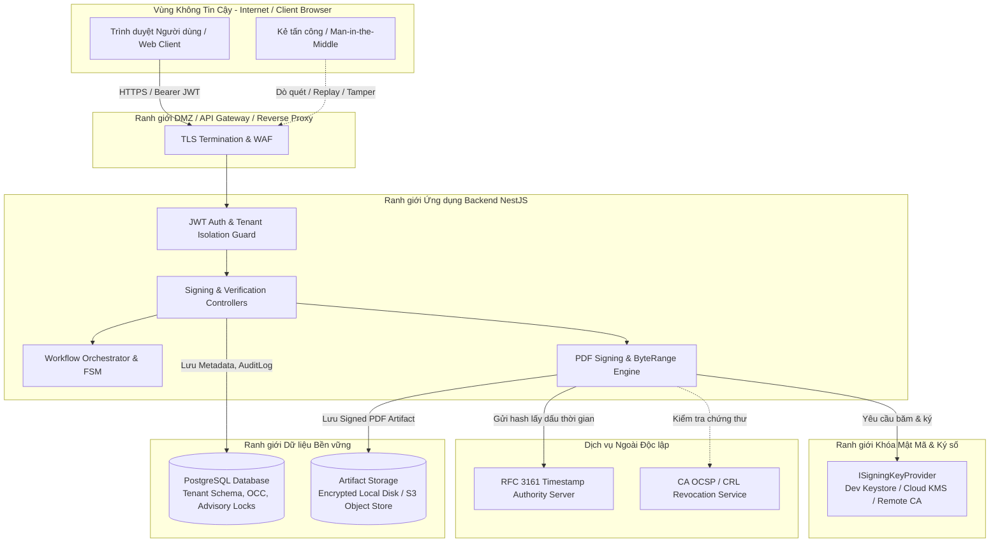

# THREAT MODEL & TRUST BOUNDARIES: HỆ THỐNG KÝ SỐ MẬT MÃ PDF
*Dự án: Trình Ký Online Nội Bộ Doanh Nghiệp / Tập Đoàn*  
*Giai đoạn: Phase 13.0 — Security Engineering & Threat Analysis*  
*Tiêu chuẩn tham chiếu: STRIDE, OWASP Top 10 API Security, ISO/IEC 27001, ETSI PAdES Security Guidelines*

---

## 1. MỤC TIÊU & RANH GIỚI TIN CẬY (TRUST BOUNDARIES)

Mô hình đe dọa này phân tích toàn bộ các bề mặt tấn công tiềm tàng đối với chức năng tạo, ký số, lưu trữ và xác minh tệp PDF có thể xác minh độc lập.

### 1.1. Bảng phân định Ranh giới Tin cậy

| Ranh giới | Thành phần bên trong | Thành phần bên ngoài | Giao thức / Kiểm soát bảo mật |
| :--- | :--- | :--- | :--- |
| **Boundary 1: Client $\rightarrow$ API** | `apps/api` (NestJS Controllers) | Trình duyệt Web, Mobile, API Consumer bên ngoài | Bắt buộc HTTPS TLS 1.3, Bearer JWT có thời hạn, Rate Limiting, Input Validation (Zod/class-validator). |
| **Boundary 2: Backend $\rightarrow$ Key Provider** | `ISigningKeyProvider` (Module Mật mã) | Ứng dụng chính NestJS | Khóa riêng không bao giờ rời khỏi Key Provider. Giao tiếp qua RAM hoặc RPC/mTLS có xác thực. |
| **Boundary 3: Backend $\rightarrow$ Persistence** | PostgreSQL, File/S3 Storage | Backend Services | PostgreSQL qua Private Network / Connection Pool xác thực mật khẩu mạnh; Storage qua IAM Role / Scoped API Keys. |
| **Boundary 4: Backend $\rightarrow$ External PKI** | TSA, OCSP/CRL Responders | Máy chủ CA công cộng / Quốc gia | Giao thức HTTP/HTTPS với cơ chế Timeout, Fallback và Circuit Breaker. |

---

## 2. DANH MỤC TÀI SẢN BẢO VỆ (ASSET INVENTORY)

| Mã | Tài sản | Định dạng / Vị trí | Mức độ nhạy cảm (C-I-A) | Hậu quả nếu bị xâm hại |
| :--- | :--- | :--- | :--- | :--- |
| **AST-01** | **Khóa riêng ký số (Private Key)** | File PKCS#12 mã hóa / Cloud KMS / HSM | **C: Tối Mật** I: Cực Cao A: Cao | Kẻ tấn công có thể giả mạo chữ ký số của tổ chức/cá nhân trên mọi tài liệu pháp lý. |
| **AST-02** | **Tệp PDF đã ký (Signed PDF Artifact)** | Nhị phân PDF lưu trong File Storage / S3 | C: Cao (Bảo mật nội bộ) **I: Tối Mật (Bất biến)** A: Cao | Văn bản bị giả mạo nội dung (sửa tiền, sửa điều khoản hợp đồng), làm sai lệch bằng chứng pháp lý. |
| **AST-03** | **Chứng thư số X.509** | X.509 ASN.1 / PEM / Database | C: Công khai **I: Rất Cao** A: Cao | Giả mạo danh tính người ký nếu chứng thư giả mạo được nhúng thành công. |
| **AST-04** | **Lịch sử Quyết định & Audit Trail** | Bảng `StepDecisionHistory`, `AuditLog` | C: Nội bộ **I: Tối Mật (Append-only)** A: Cao | Xóa vết hành vi phạm pháp, đổ vấy trách nhiệm cho người khác. |
| **AST-05** | **Chính sách Ủy quyền (Delegation Policy)** | Bảng `delegation_policies` | C: Nội bộ **I: Tối Mật** A: Cao | Chiếm đoạt quyền phê duyệt và quyền ký của lãnh đạo. |
| **AST-06** | **Dữ liệu Form & Snapshot (FormData JSON)** | Bảng `document_versions` | C: Cao **I: Tối Mật** A: Cao | Sai lệch giữa dữ liệu lưu trên giao diện web và dữ liệu trên bản in PDF. |

---

## 3. CHÂN DUNG TÁC NHÂN TẤN CÔNG (THREAT ACTOR PROFILES)

1. **Attacker Ngoài (External Anonymous Attacker):** Tin tặc trên Internet không có tài khoản, cố gắng khai thác lỗ hổng parser PDF, brute-force API, giả mạo token, hoặc nghe lén mạng.
2. **Người dùng Độc hại trong Tổ chức (Malicious Insider - Employee):** Người dùng có tài khoản hợp lệ của Công ty A, cố gắng truy cập hoặc ký hồ sơ của Công ty B (Cross-tenant attack), hoặc sửa đổi nội dung PDF sau khi sếp đã bấm duyệt.
3. **Người duyệt muốn Chối bỏ Trách nhiệm (Repudiating Approver):** Người đã thực hiện ký duyệt nhưng sau đó khi xảy ra sự cố muốn tuyên bố: *"Tôi không ký tài liệu này, hệ thống bị lỗi hoặc bị giả mạo"*.
4. **Quản trị viên Lạm quyền (Rogue Administrator):** Nhân sự IT có quyền `ADMIN` hoặc `SUPER_ADMIN`, cố gắng sửa trực tiếp database hoặc tệp tin trên disk để hợp thức hóa hồ sơ sai trái.
5. **Kẻ Tấn công Chuỗi Cung ứng (Supply Chain / Infrastructure Attacker):** Lỗ hổng trong các thư viện xử lý PDF của bên thứ ba, lỗ hổng container Docker hoặc cấu hình sai quyền storage bucket.

---

## 4. MA TRẬN ĐÁNH GIÁ ĐE DỌA CHI TIẾT (COMPREHENSIVE THREAT MATRIX)

Dưới đây là ma trận phân tích chuyên sâu cho các kịch bản đe dọa bắt buộc theo yêu cầu kiến trúc:

| ID | Tài sản mục tiêu | Kịch bản tấn công (Attack Scenario) | Tác động (Impact) | Biện pháp phòng vệ (Countermeasures) | Kiểm thử bắt buộc (Required Tests) | Rủi ro còn lại & Giả định (Residual Risk & Assumptions) |
| :--- | :--- | :--- | :--- | :--- | :--- | :--- |
| **THR-01** | **Signed PDF Artifact (AST-02)** | **Sửa tệp PDF sau khi ký:** Kẻ tấn công sửa trực tiếp nội dung văn bản (đổi số tiền từ 10 triệu thành 100 triệu) bằng công cụ chỉnh sửa PDF hoặc binary editor. | **Thảm họa:** Thất thoát tài chính, vô hiệu giá trị pháp lý của tài liệu. | **1.** Chữ ký số CMS bao phủ ByteRange từ byte 0 đến EOF. **2.** Nếu sửa 1 byte duy nhất trong phạm vi được ký, hash tính toán không khớp với hash giải mã từ chữ ký số. **3.** Mọi trình đọc PDF (Adobe Reader, verifier API) phát hiện và cảnh báo ngay lập tức. | Sửa ngẫu nhiên 1 byte trong vùng ByteRange và kiểm tra xem `pdf-verifier` cùng Adobe Acrobat có báo lỗi "Signature Invalid / Document Tampered" hay không. | *Giả định:* Thuật toán SHA-256 và RSA/ECDSA không bị bẻ gãy. Nếu kẻ tấn công ký đè Incremental Update nhưng thêm trang mới, chữ ký cũ vẫn hợp lệ nhưng verifier phải cảnh báo có sửa đổi sau ký. |
| **THR-02** | **Signed PDF Artifact (AST-02)** | **Thay tệp giữa lúc băm và lưu trữ (Time-of-Check to Time-of-Use - TOCTOU):** Tệp PDF được băm lúc 10:00:00, nhưng trước khi upload lên Storage hoặc trước khi chèn chữ ký, tệp bị thay thế bởi một tệp khác. | **Nghiêm trọng:** Ký số trên một nội dung nhưng lưu trữ tệp nội dung khác, gây sai lệch nghiêm trọng. | **1.** Toàn bộ quy trình sinh PDF, tính băm, chèn chữ ký và upload diễn ra trong bộ nhớ RAM (In-Memory Buffer), không ghi file tạm không kiểm soát ra thư mục `/tmp` công cộng. **2.** Sau khi upload lên Storage, tính lại SHA-256 nhị phân của tệp đã lưu và đối chiếu với `signedPdfHash` ghi vào DB trong cùng Transaction. | Tái hiện giả lập thao tác tiêm file khác vào giữa bước ký và bước lưu, xác nhận hệ thống rollback transaction và xóa file rác. | *Giả định:* Bộ nhớ RAM của tiến trình Node.js không bị can thiệp bởi mã độc tầng root OS. |
| **THR-03** | **Workflow & Audit (AST-04)** | **Replay request ký hoặc ký hai lần (Double Signing / Replay Attack):** Người dùng bấm nút ký nhiều lần hoặc mạng gửi lại request ký làm hệ thống ký 2 lần, sinh 2 chữ ký thừa hoặc làm hỏng cấu trúc Incremental Update. | **Trung bình - Cao:** Hỏng tệp PDF, duplicate audit event, tranh chấp trạng thái trong FSM. | **1.** Client gửi kèm `idempotencyKey` độc nhất cho mỗi thao tác ký. **2.** Sử dụng PostgreSQL Transaction Advisory Lock theo `documentId` (`pg_advisory_xact_lock`). **3.** Kiểm tra trạng thái hiện tại của bước duyệt: Nếu bước đã `COMPLETED` hoặc văn bản đã `APPROVED`, từ chối request trùng lặp ngay lập tức (`409 Conflict`). | Chạy 10 request ký đồng thời bằng Promise.all với cùng token và payload; kiểm tra chỉ duy nhất 1 request thực thi thành công, 9 request còn lại bị chặn hoặc trả về kết quả đã ký. | *Giới hạn:* Nếu client sinh mã `idempotencyKey` mới cho cùng một hành động do lỗi logic frontend, hệ thống vẫn phải dựa vào khóa FSM và Advisory Lock trong DB để chặn ký lặp. |
| **THR-04** | **Chứng thư số (AST-03)** | **Dùng chứng thư hết hạn, bị thu hồi hoặc giả mạo chủ thể:** Người dùng sử dụng chứng thư đã hết hiệu lực, hoặc chứng thư đã bị thu hồi (do lộ khóa/thôi việc), hoặc chứng thư của người khác để ký duyệt. | **Nghiêm trọng:** Chữ ký không có giá trị pháp lý, kẻ mạo danh ký thay người có thẩm quyền. | **1.** Kiểm tra tính hợp lệ về thời gian (`notBefore <= now <= notAfter`). **2.** Kiểm tra bảng `digital_certificates`: Trạng thái bắt buộc là `ACTIVE` (không phải `REVOKED` hay `EXPIRED`). **3.** Kiểm tra ánh xạ danh tính: `certificate.userId === currentUser.id` (nếu là chữ ký cá nhân) hoặc `currentUser.role === ADMIN` và thuộc đúng `organizationId` (nếu là con dấu tổ chức). **4.** Kiểm tra OCSP/CRL khi có cấu hình CA ngoài. | Kiểm thử ký bằng chứng thư hết hạn $\rightarrow$ Bị chặn `400 Bad Request`; Ký bằng chứng thư đã bị revoke $\rightarrow$ Bị chặn `403 Forbidden`; Dùng cert của User A cho User B $\rightarrow$ Bị chặn `403 Forbidden`. | *Rủi ro còn lại:* Nếu CA ngoài không khả dụng (OCSP timeout), hệ thống cần áp dụng chính sách cấu hình Soft-fail hoặc Hard-fail (xem THR-10). |
| **THR-05** | **Khóa riêng (AST-01)** | **Chiếm quyền API hoặc sử dụng khóa riêng trái phép:** Kẻ tấn công đánh cắp JWT của người duyệt hoặc khai thác lỗ hổng API để gọi endpoint ký mà không có thẩm quyền. | **Thảm họa:** Khóa riêng bị lạm dụng để ký các văn bản trái phép mà người sở hữu không hề hay biết. | **1.** Khóa riêng được cách ly trong `ISigningKeyProvider`, tuyệt đối không bao giờ trả về qua API. **2.** Endpoint ký kiểm tra đa lớp: JWT Signature $\rightarrow$ Tenant Isolation $\rightarrow$ Quyền Assignee hiện tại của bước trong FSM $\rightarrow$ Quyền sở hữu chứng thư. **3.** Đối với môi trường Production, áp dụng xác thực cấp hai (Step-up Auth / OTP) trước khi thực hiện ký. | Thử gọi API ký với token của người không thuộc danh sách người duyệt $\rightarrow$ Chặn `403 Forbidden`; Thử gọi API ký trên tài liệu đã hoàn thành $\rightarrow$ Chặn `400 Bad Request`. | *Rủi ro còn lại:* Nếu người dùng để lộ hoàn toàn JWT và mã OTP cá nhân, kẻ tấn công vẫn có thể thực hiện ký hợp pháp từ góc độ hệ thống. |
| **THR-06** | **Tài sản Đa Doanh nghiệp (AST-02, AST-03)** | **Cross-Tenant Access đến PDF, Metadata hoặc Verification:** Người dùng thuộc Công ty Alpha (Tenant A) cố tình tải tệp PDF, xem metadata chứng thư hoặc ký tài liệu thuộc Công ty Beta (Tenant B). | **Nghiêm trọng:** Vi phạm bảo mật thông tin kinh doanh, lộ bí mật thương mại giữa các công ty thành viên. | **1.** Toàn bộ truy vấn DB đều có mệnh đề lọc cứng `WHERE organizationId = user.organizationId` (áp dụng triệt để cho `Document`, `DocumentVersion`, `DigitalCertificate`). **2.** Controller tải file kiểm tra quyền sở hữu tổ chức trước khi cấp luồng đọc nhị phân từ storage. **3.** Endpoint xác minh công khai (Public Verification) chỉ trả về kết quả kiểm tra tính toàn vẹn (Hợp lệ / Bị sửa) và metadata cơ bản, tuyệt đối không trả về nội dung nhạy cảm của form nếu người gọi không có quyền truy cập tài liệu. | Thử dùng token User Công ty Alpha gọi GET file PDF của Công ty Beta $\rightarrow$ Chặn `403 Forbidden`; Thử dùng chứng thư của Beta để ký văn bản Alpha $\rightarrow$ Chặn `403 Forbidden`. | *Giả định:* Hệ thống phân quyền RBAC và Tenant Guard hoạt động đúng như đã kiểm chứng ở Phase 12.1.1. |
| **THR-07** | **Chính sách Ủy quyền (AST-05)** | **Ủy quyền bị thu hồi hoặc hết hạn trong lúc yêu cầu ký đang được xử lý (Race Condition):** Giám đốc A bấm "Thu hồi ủy quyền" đối với Phó giám đốc B đúng lúc Phó giám đốc B đang gửi request ký số tài liệu. | **Cao:** Tài liệu được ký bởi người đã bị tước quyền, dẫn đến tranh chấp pháp lý nội bộ. | **1.** Kế thừa cơ chế Pessimistic Locking từ Phase 12.1.1: Transaction ký số thực hiện `SELECT id, "isActive", "startDate", "endDate" FROM delegation_policies WHERE id = $1 FOR UPDATE`. **2.** Nếu transaction revoke đã commit trước: Request ký bị từ chối ngay lập tức `403 Forbidden`. **3.** Nếu transaction ký số đi trước: Chữ ký được hoàn tất và ghi nhận hợp lệ; transaction revoke sau đó thu hồi hiệu lực cho các văn bản tiếp theo. | Tái hiện 2 request đồng thời (Revoke Policy vs Sign with Delegation) và kiểm tra tính nhất quán tuyệt đối của DB và tệp PDF. | *Giả định:* Cơ chế khóa PostgreSQL FOR UPDATE hoạt động nhất quán trên cùng một connection transaction. |
| **THR-08** | **Audit Trail (AST-04)** | **Quản trị viên sửa metadata hoặc xóa bằng chứng audit:** Một quản trị viên biến chất truy cập trực tiếp vào DB để sửa người ký hoặc xóa bản ghi log nhằm xóa dấu vết. | **Nghiêm trọng:** Mất khả năng giải trình và kiểm toán pháp lý độc lập. | **1.** Chữ ký số nằm trong tệp PDF nhị phân độc lập với DB: Việc sửa DB không làm thay đổi thông tin người ký và chứng thư số đã đóng băng vĩnh viễn trong cấu trúc CMS của PDF. **2.** Kiểm tra tính độc lập: Khi kiểm toán, dùng công cụ độc lập mở tệp PDF để đọc Subject DN của chứng thư đã ký, không dựa đơn thuần vào bảng `SignatureEvent`. **3.** Cơ chế AuditLog append-only (chỉ INSERT, không cho phép UPDATE/DELETE). | Kiểm tra việc sửa đổi tên người ký trong bảng `SignatureEvent` không ảnh hưởng đến kết quả xác minh nhị phân của tệp PDF. | *Rủi ro còn lại:* Nếu quản trị viên có quyền can thiệp cả DB và thay đổi toàn bộ tệp tin trên Storage bằng tệp mới, cần áp dụng S3 Object Lock (WORM - Write Once Read Many) cho môi trường Production. |
| **THR-09** | **Hệ thống & Động cơ PDF** | **PDF Parser Bombs, Malformed PDF và Lỗ hổng Thư viện:** Kẻ tấn công tải lên file PDF giả mạo cấu trúc, chứa đệ quy vô hạn (Billion Laughs / Zip Bomb), hoặc PDF độc hại gây tràn bộ đệm thư viện parser. | **Cao:** Treo hệ thống (Denial of Service), cạn kiệt tài nguyên CPU/RAM, sập tiến trình Node.js API. | **1.** Giới hạn dung lượng tệp tối đa (ví dụ: tối đa 20MB cho mỗi tệp PDF). **2.** Thiết lập timeout nghiêm ngặt cho tiến trình render và ký (ví dụ: timeout 15 giây). **3.** Xử lý ngoại lệ an toàn bọc quanh toàn bộ các hàm phân tích PDF; không để lỗi parser làm crash process Node.js. **4.** Cập nhật thường xuyên các bản vá bảo mật của thư viện xử lý PDF. | Tải lên file PDF bị cắt cụt (truncated EOF), file kích thước vượt ngưỡng cho phép, và file cấu trúc vòng đệ quy; kiểm tra API trả về mã lỗi 400 có kiểm soát mà không crash server. | *Rủi ro còn lại:* Lỗ hổng zero-day trong các thư viện C++ biên dịch nhúng (nếu có). |
| **THR-10** | **Dịch vụ Ngoài (TSA / OCSP)** | **Máy chủ Timestamp (TSA) hoặc OCSP/CRL không thể truy cập được:** Mạng Internet gặp sự cố, dịch vụ TSA của nhà mạng bị downtime làm request ký số bị nghẽn hoặc thất bại. | **Trung bình:** Làm gián đoạn quy trình phê duyệt khẩn cấp của doanh nghiệp. | **1.** Thiết lập timeout ngắn (ví dụ: 3 giây) khi kết nối tới TSA/OCSP ngoài. **2.** Cấu hình chính sách xử lý linh hoạt theo cấp bậc tài liệu: - *Chế độ Bắt buộc (Strict/Hard-fail)*: Cho các hợp đồng tài chính giá trị lớn $\rightarrow$ Báo lỗi và dừng ký nếu TSA không phản hồi. - *Chế độ Linh hoạt (Soft-fail / Local Fallback)*: Cho các tờ trình nội bộ thông thường $\rightarrow$ Tạm thời ký số không nhúng timestamp của TSA ngoài (ký theo chuẩn PAdES B-B với thời gian hệ thống nội bộ đã đồng bộ NTP). | Giả lập ngắt kết nối mạng tới TSA server; kiểm tra hành vi ứng xử tương ứng theo cấu hình strict/fallback. | *Giới hạn:* Nếu chọn soft-fail, văn bản ký trong giai đoạn này sẽ không có chứng nhận thời gian từ bên thứ ba độc lập. |
| **THR-11** | **Bảo đảm Toàn vẹn (AST-02, AST-04)** | **Lỗi giữa các bước ký, lưu file, cập nhật DB và ghi audit (Partial Failure):** File đã ký được upload lên storage nhưng server mất điện hoặc DB timeout trước khi kịp lưu thông tin vào PostgreSQL. | **Nghiêm trọng:** Dữ liệu bất nhất (Inconsistency); file mồ côi chiếm dụng bộ nhớ; người dùng nghĩ ký thất bại nên ký lại nhiều lần. | **1.** Thực thi theo mô hình Two-Phase Commit có cơ chế đền bù (Compensating Transaction): - Tạo bản ghi trạng thái `SIGNING_IN_PROGRESS` trước khi gửi lệnh ký. - Nếu upload thành công nhưng DB commit thất bại $\rightarrow$ Background job định kỳ phát hiện các tệp mồ côi (Orphan Cleanup Worker) hoặc hoàn tất việc đồng bộ. **2.** Lưu trữ tệp với đường dẫn định danh có chứa mã hash nội dung (Content-Addressable Storage pattern) để tránh ghi đè. | Giả lập ngắt kết nối DB ngay sau khi upload file lên Storage; kiểm tra cơ chế rollback và cleanup. | *Giả định:* Cơ chế worker dọn dẹp chạy định kỳ và có quyền truy cập dọn dẹp storage. |
| **THR-12** | **Khóa riêng & Keystore (AST-01)** | **Xâm nhập máy chủ và lộ mật khẩu giải mã Keystore (Host Compromise & Secret Disclosure):** Kẻ tấn công chiếm quyền truy cập filesystem máy chủ backend (`storage/keystores/dev/`) đồng thời đọc được biến môi trường `DEV_SIGNING_PASSPHRASE`. | **Thảm họa:** Toàn bộ khóa riêng PKCS#12 bị trích xuất, kẻ tấn công có thể tạo chữ ký giả mạo ngoài hệ thống. | **1.** Chỉ cho phép dùng `DevLocalKeystoreProvider` trong môi trường Development / CI/CD với chứng thư gắn nhãn "DEV TEST ONLY". **2.** Trong môi trường Production, **BẮT BUỘC** chuyển sang `CloudKmsSigningProvider` hoặc `SmartCaSigningProvider` (AWS KMS, Google Cloud KMS, Azure Key Vault, HSM FIPS 140-2 Level 3, VNPT SmartCA). Khi đó khóa riêng được sinh và bảo vệ vĩnh viễn trong phần cứng cryptographic hardware, không bao giờ xuất hiện trên filesystem máy chủ backend. **3.** Chặn đứng Path Traversal, không bao giờ ghi log mật khẩu hoặc keystore bytes. | Kiểm tra unit test và integration test xác nhận không có bất kỳ log hay error message nào in ra mật khẩu giải mã hoặc PEM private key. | *Giới hạn của Local Keystore:* PKCS#12 được mã hóa bằng AES-256-CBC chỉ bảo vệ khóa khi tệp bị đánh cắp độc lập với mật khẩu. Nếu server và biến môi trường cùng bị lộ, mã hóa phần mềm không thể thay thế HSM phần cứng. |
| **THR-13** | **Cấu trúc PDF & ByteRange (AST-02)** | **Tấn công Thao túng ByteRange & Shadow Attack (PDF Shadow Attacks):** Kẻ tấn công sửa đổi các giá trị trong mảng `/ByteRange` để loại trừ các trang nội dung nhạy cảm ra khỏi phạm vi băm, hoặc chèn thêm nội dung hiển thị đè ("Shadow Objects") ngoài vùng băm. | **Nghiêm trọng:** Nội dung hiển thị với người đọc bị thay đổi nhưng chữ ký số vẫn báo hợp lệ do nội dung giả mạo nằm ngoài vùng tính hash. | **1.** `PdfSignatureVerifier` kiểm tra độ bao phủ nghiêm ngặt của `/ByteRange`: Đoạn 1 bắt buộc bắt đầu từ byte 0 (`offset1 === 0`), kết thúc ngay trước ký tự `<` mở đầu vùng `/Contents`; Đoạn 2 bắt buộc bắt đầu ngay sau ký tự `>` kết thúc vùng `/Contents` và kéo dài đến chính xác byte cuối cùng của tệp PDF (`offset2 + len2 === totalFileSize`). **2.** Bất kỳ byte nào của tệp PDF (ngoại trừ chính chuỗi hex của chữ ký trong `/Contents`) nằm ngoài ByteRange đều bị phát hiện và kết luận `isTampered: true`, `isValid: false`. | Test 74 trong bộ Live E2E và Unit Tests cố tình thay đổi ByteRange hoặc sửa đổi byte nội dung $\rightarrow$ Verifier từ chối ngay lập tức. | *Đảm bảo:* Cấu trúc PDF được bao phủ 100% không có vùng mù. |
| **THR-14** | **Tràn Bộ đệm Placeholder (AST-02)** | **Kích thước Chữ ký CMS vượt quá Dung lượng Cấp phát (Placeholder Overflow):** Chuỗi DER của chữ ký CMS (chứa chuỗi chứng thư dài hoặc nhiều thuộc tính ký) dài hơn vùng đệm hex đã dự trù trong `/Contents`, dẫn đến việc ghi đè làm dịch chuyển cấu trúc byte và hỏng bảng tham chiếu chéo (xref table). | **Cao:** Hỏng cấu trúc tệp PDF, gây lỗi không mở được tài liệu hoặc tạo ra tệp PDF không thể xác minh. | **1.** `PdfSignatureAdapter` cấp phát vùng đệm an toàn 8192 bytes (16384 hex characters). **2.** Kiểm tra kích thước nghiêm ngặt trước khi nhúng: `cmsDer.length <= placeholderByteLength`. Nếu CMS vượt quá dung lượng, hệ thống ném ngoại lệ `BadRequestException` lập tức thay vì ghi đè. **3.** Quy trình ký là Fail-closed: Bắt buộc tự xác minh (`PdfSignatureVerifier.verify`) thành công 100% mới cho phép ghi vào kho lưu trữ. | Unit test kiểm thử CMS vượt dung lượng $\rightarrow$ Ném ngoại lệ an toàn, không sinh tệp hỏng. | *Đảm bảo:* PDF sau khi nhúng giữ nguyên 100% vị trí offset và toàn vẹn cấu trúc xref. |
| **THR-15** | **Dấu thời gian RFC 3161 (AST-02, AST-03)** | **Tấn công Phát lại Token hoặc Giả mạo Dấu thời gian (RFC 3161 Replay & Timestamp Tampering):** Kẻ tấn công đánh cắp TimeStampToken cũ để nhúng vào chữ ký mới, hoặc sửa đổi thời gian `genTime`/nội dung nhị phân bên trong token. | **Nghiêm trọng:** Làm sai lệch bằng chứng thời điểm ký, vi phạm tính bất thoái thác (Non-Repudiation), hợp thức hóa chữ ký sau khi chứng thư đã bị thu hồi. | **1.** Sinh `nonce` ngẫu nhiên 64-bit trong mỗi `TimeStampReq` và kiểm tra khớp 100% trong `TimeStampResp`. **2.** Bắt buộc `messageImprint` trong `TSTInfo` phải khớp chính xác với `SHA-256(SignerInfo.signatureValue)`. **3.** `TimestampTokenVerifier` xác minh chữ ký RSA của TSA trên cấu trúc `TSTInfo`. Bất kỳ thay đổi nào làm chữ ký TSA không hợp lệ. **4.** Khi token bị hỏng/can thiệp, hệ thống đánh dấu `isTampered: true, isValid: false`. | Test 2, 3, 5 trong `timestamp-token.verifier.spec.ts` và Test 7 trong `pdf-signature.verifier.spec.ts` $\rightarrow$ Từ chối và phát hiện can thiệp tức thì. | *Đảm bảo:* Dấu thời gian gắn chặt duy nhất với chữ ký người ký cụ thể, không thể phát lại hay can thiệp. |
| **THR-16** | **Chứng thư TSA (AST-03)** | **Thay thế Chứng thư TSA hoặc Thiếu Thuộc tính EKU (TSA Certificate Substitution & Missing EKU):** Kẻ tấn công sử dụng chứng thư thông thường (không được cấp quyền TimeStamping) để ký token, hoặc thay thế chứng thư TSA bằng chứng thư khác. | **Nghiêm trọng:** Dấu thời gian không có giá trị pháp lý theo chuẩn ETSI EN 319 142-1 / RFC 3161. | **1.** Kiểm tra Extended Key Usage (EKU) của chứng thư TSA: Bắt buộc phải có OID `1.3.6.1.5.5.7.3.8` (`id-kp-timeStamping`). **2.** Kiểm tra thời hạn hiệu lực của chứng thư TSA tại thời điểm `genTime`. **3.** Bắt buộc `SignedAttributes` của TSA phải chứa ESS `signingCertificateV2` (RFC 5035) để khóa chặt danh tính chứng thư với chữ ký. | Test 4 trong `timestamp-token.verifier.spec.ts` $\rightarrow$ Bị chặn ngay khi thiếu EKU timeStamping; OpenSSL `ts -verify` đạt `Verification: OK`. | *Đảm bảo:* Chỉ các chứng thư được cấp phép và cấu hình đúng mục đích TSA mới được chấp thuận. |
| **THR-17** | **Dịch vụ Thu hồi & Mạng (AST-03, AST-06)** | **Tấn công SSRF và Dữ liệu Độc hại khi Thu thập OCSP/CRL (SSRF & Malicious Payload via AIA/CRL DP):** Kẻ tấn công cung cấp chứng thư X.509 chứa URL AIA OCSP hoặc CRL Distribution Point trỏ tới dịch vụ nội bộ (Cloud Metadata `169.254.169.254`, loopback `127.0.0.1`, Redis, Kubernetes API) hoặc payload khổng lồ làm sập server. | **Thảm họa:** Rò rỉ thông tin hạ tầng nội bộ, cloud credentials, cạn kiệt bộ nhớ hoặc Denial of Service. | **1.** `SsrfProtectionUtil` kiểm tra và phân giải DNS trước khi gửi request HTTP: Chặn tuyệt đối loopback (`127.0.0.0/8`), private IP (`10.0.0.0/8`, `172.16.0.0/12`, `192.168.0.0/16`), link-local / cloud metadata (`169.254.0.0/16`), IPv6 loopback (`::1`), unique local (`fc00::/7`). **2.** Chỉ cho phép giao thức `http` và `https`. **3.** Giới hạn dung lượng tải về nghiêm ngặt (128KB cho OCSP, 10MB cho CRL). **4.** Timeout tối đa 5000ms, không cho phép redirect quá 2 lần. | Bộ kiểm thử `ssrf-protection.spec.ts` (5 tests) xác minh chặn 100% các IP nguy hiểm và URL scheme không hợp lệ. | *Đảm bảo:* Dịch vụ thu hồi hoạt động an toàn trong môi trường mạng nội bộ và cloud. |
| **THR-18** | **Cấu trúc PDF & DSS (AST-02)** | **Can thiệp Nhị phân sau Chữ ký & PDF Shadow Attacks trong DSS Update:** Kẻ tấn công lợi dụng tính năng Incremental Update để chèn thêm các trang mới, sửa đổi nội dung hiển thị hoặc tiêm mã độc sau chữ ký gốc. | **Nghiêm trọng:** Thay đổi nội dung hiển thị văn bản sau khi đã ký mà người nhận tưởng rằng văn bản đạt chuẩn PAdES B-LT. | **1.** `PdfSignatureVerifier` kiểm tra toàn bộ phần dữ liệu sau `offset2 + len2`: Chỉ cho phép đối tượng thuộc Document Security Store (`/DSS`, `/VRI`), bảng xref, và trailer. **2.** Bất kỳ đối tượng hiển thị nào (`/Type /Page`, `/MediaBox`, `/Annots`, `/Contents`) xuất hiện trong phần incremental update đều bị phát hiện ngay lập tức và đánh dấu `isTampered: true, isValid: false` ("Phát hiện hành vi PDF Shadow Attack"). **3.** Kiểm tra toàn vẹn chữ ký số trên OCSP Response / CRL nhúng trong DSS; nếu bị thu hồi hoặc sai chữ ký, hệ thống từ chối cấp trạng thái B-LT. | Test 4 trong `pdf-dss.spec.ts` kiểm thử chèn đối tượng `/Type /Page` sau chữ ký $\rightarrow$ Verifier từ chối ngay lập tức và cảnh báo Shadow Attack. | *Đảm bảo:* Chỉ các bản cập nhật chứa dữ liệu bảo mật DSS hợp lệ mới được chấp thuận. |

---

## 5. ĐÁNH GIÁ RỦI RO CÒN LẠI (RESIDUAL RISK SUMMARY)

Không có hệ thống nào an toàn 100%. Dưới đây là bảng đánh giá rủi ro còn lại sau khi đã áp dụng đầy đủ các biện pháp thiết kế kiến trúc:

| Rủi ro còn lại | Mức độ sau kiểm soát | Biện pháp giảm thiểu bổ sung trong vận hành thực tế |
| :--- | :--- | :--- |
| **Mất cắp thiết bị / Khóa truy cập của Quản trị viên cấp cao** | Thấp | Bắt buộc bật xác thực đa yếu tố (MFA/FIDO2) cho toàn bộ tài khoản `SUPER_ADMIN`; áp dụng mô hình phân tách nhiệm vụ (Separation of Duties). |
| **Lỗ hổng zero-day trong thư viện PDF/Cryptographic bên thứ ba** | Trung bình | Định kỳ chạy kiểm tra lỗ hổng phụ thuộc (`pnpm audit`), quét bảo mật tự động bằng Snyk/Dependabot, cô lập tiến trình render PDF trong sandbox. |
| **Gian lận thông đồng (Collusion) giữa Người ủy quyền và Người nhận ủy quyền** | Thấp | Nhật ký kiểm toán bất biến (Immutable Audit Trail) ghi nhận đầy đủ IP, UserAgent, thời gian và chính sách ủy quyền phục vụ điều tra hình sự/pháp lý. |
| **Tranh chấp về thời gian ký khi không có dấu thời gian TSA** | Đã giải quyết (Phase 13.3.1) | Hỗ trợ cờ `requireTimestamp: true` với RFC 3161 TSA và fail-closed defense, xác minh độc lập bằng OpenSSL 3.5.7. |
| **Hết hạn dịch vụ CA hoặc OCSP/CRL không thể truy cập dài hạn** | Đã giải quyết (Phase 13.3.2) | Nhúng đầy đủ chuỗi chứng thực và dữ liệu thu hồi vào Document Security Store (DSS / VRI) theo chuẩn PAdES Baseline B-LT, cho phép thẩm định ngoại tuyến dài hạn. |
| **Suy giảm độ an toàn thuật toán mật mã theo thời gian (Cryptographic Decay)** | Phạm vi Tương lai (PAdES B-LTA) | Khi các thuật toán hiện tại (SHA-256, RSA 2048) suy yếu trong tương lai, cần cơ chế Document Timestamp định kỳ để bao bọc bằng chứng bảo mật dài hạn (PAdES B-LTA). |

---

## 6. KẾT LUẬN THREAT MODEL

Mô hình bảo mật của Phase 13 xác lập các nguyên tắc cốt lõi:
1. **Kiểm tra Mật mã thay vì tin tưởng Metadata**: Tính hợp lệ của tài liệu được quyết định bởi chữ ký toán học nhúng trong tệp PDF chứ không chỉ dựa vào cờ `isValid` trong PostgreSQL.
2. **Cách ly tuyệt đối Khóa riêng**: Khóa riêng không bao giờ xuất hiện ở frontend, không bao giờ ghi log, không lưu dạng plaintext, và không bao giờ export ra khỏi Provider interface.
3. **Phòng thủ đa lớp (Defense in Depth)**: Kết hợp RBAC, Tenant Isolation, Advisory Locks, Incremental Updates, Independent Verification, RFC 3161 TSA Verifier, và SSRF Defense để vô hiệu hóa các vector tấn công từ ngoài lẫn nội bộ.

